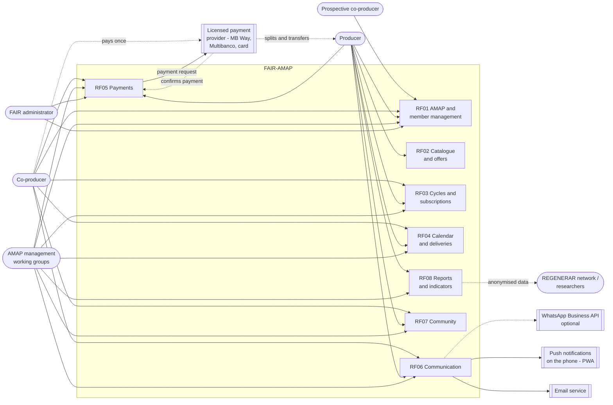

# Context and actors diagram

**Updated on:** 13/11/2026 · SRS section: 2.1 Product perspective

Shows who uses FAIR-AMAP, which features each actor uses and which external systems the platform communicates with. Collection is **centralised through a licensed payment provider** (group proposal of 21/10, accepted by FAIR in E-8) and **invoicing is out of scope** (E-6).

**Image (for the SRS):** [imagens/DiagramaContextoEN.png](imagens/DiagramaContextoEN.png)

## Notes
- **Centralised collection** (group proposal of 21/10, validated in E-8): the co-producer makes a single payment through a **licensed payment provider**, which splits it among producers; the system calculates, requests and records payments but does not hold the money (FR-31 to FR-33, NFR-19).
- **Invoicing is out of scope** (E-6): each producer issues invoices in their own software (NFR-18).
- **Notifications** arrive by email and, if the user turns them on, as push notifications on the phone (NFR-15); WhatsApp is optional, only through the official WhatsApp Business API (FR-38).
- The **FAIR administrator** authorises the registration of new AMAPs (E-8) and uses payments to calculate the amount FAIR charges (FR-34).
- **AMAP management** may be one person, a committee or several volunteer working groups (D-C §4.5).

## Changes
- New links: producer → RF01 (application, FR-08, E-8), RF07 (events, FR-41), RF08 (exports, FR-42); co-producer → RF01 (registration, consents, departure) and RF06 (messages, FR-37); management → RF05 (payment tracking, FR-33).
- **WhatsApp Business API** added as an optional channel (FR-38).