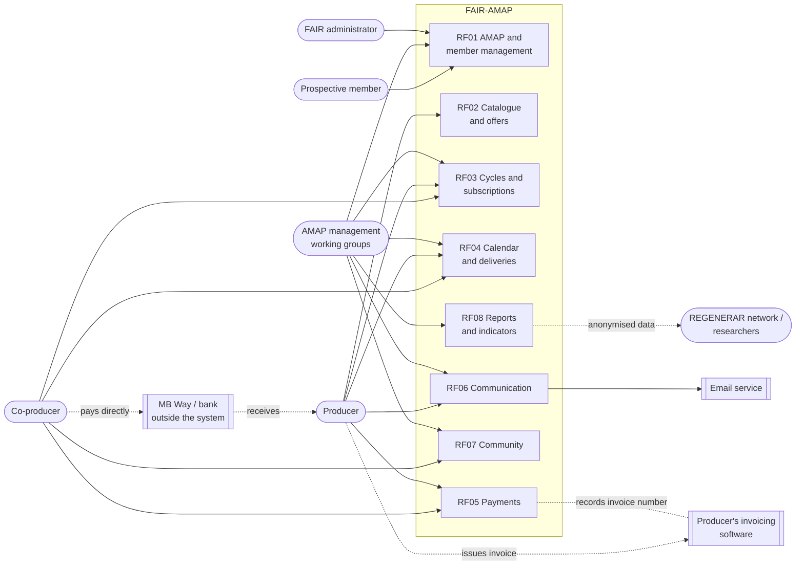

# Context and actors diagram

**Updated on:** 14/10/2026 · SRS section: 2.1 Product perspective

Shows who uses FAIR-AMAP, which features each actor uses and which external systems the platform communicates with. Payments and invoices stay **outside the system**, following scope proposal C6 (to validate).

**Image (for the SRS):** [imagens/DiagramaContextoEN.png](imagens/DiagramaContextoEN.png)

## Notes

- The **co-producer pays the producer directly** (bank transfer, MB Way or cash). The system only calculates, shows and records payments (RF-PAG-03 to 05).
- The **producer issues invoices in their own software**. The system only records the invoice reference (RF-PAG-07).
- **AMAP management** may be one person, a committee or several volunteer working groups (D-C §4.5).
