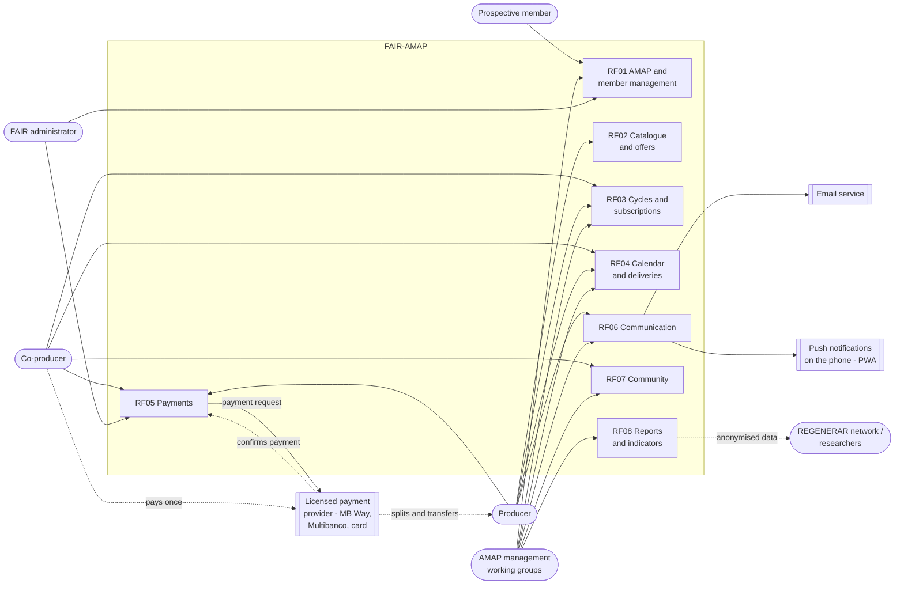

# Context and actors diagram

**Updated on:** 28/10/2026 · SRS section: 2.1 Product perspective

Shows who uses FAIR-AMAP, which features each actor uses and which external systems the platform communicates with. Collection is **centralised through a licensed payment provider** (group proposal of 21/10) and **invoicing is out of scope** (E-6).

**Image (for the SRS):** [imagens/DiagramaContextoEN.png](imagens/DiagramaContextoEN.png)

## Notes

- **Centralised collection** (group proposal of 21/10): the co-producer makes a single payment through a **licensed payment provider**, which splits it among producers; the system calculates, requests and records payments but does not hold the money (FR-31 to 04, NFR-19).
- **Invoicing is out of scope** (E-6): each producer issues invoices in their own software (NFR-18).
- **Notifications** arrive by email and, if the user turns them on, as push notifications on the phone (NFR-15).
- The **FAIR administrator** uses payments to calculate the amount FAIR charges (FR-34).
- **AMAP management** may be one person, a committee or several volunteer working groups (D-C §4.5).
