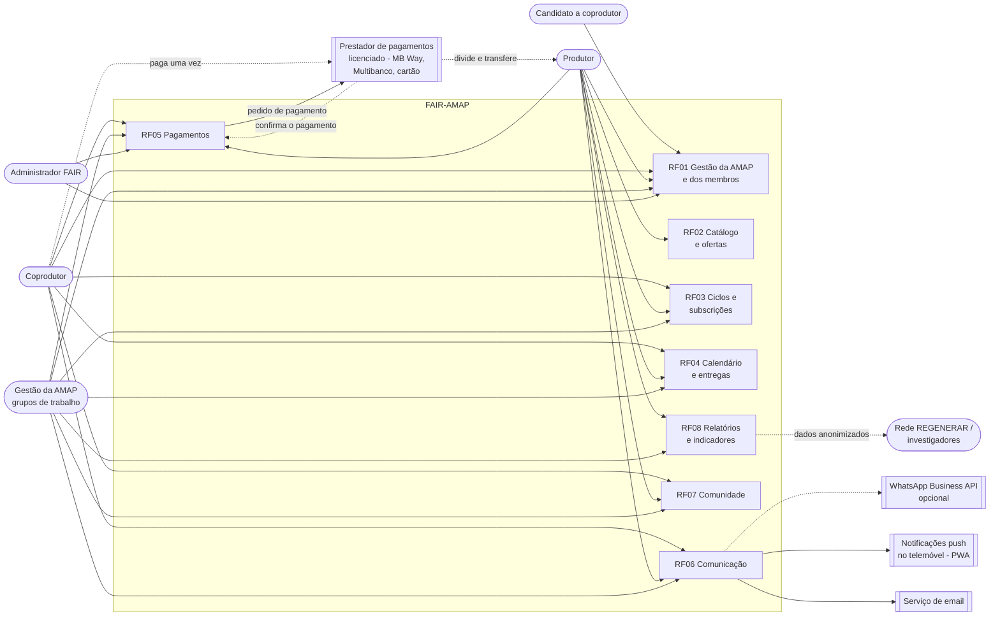

# Diagrama de contexto e atores

**Atualizado em:** 13/11/2026 · Secção do SRS: 2.1 Perspetiva do produto

Mostra quem usa a FAIR-AMAP, que funcionalidades cada ator usa e com que sistemas externos a plataforma comunica. A cobrança é **centralizada através de um prestador de pagamentos licenciado** (proposta do grupo de 21/10, aceite pela FAIR na E-8) e **a faturação está fora do âmbito** (E-6).

**Imagem (para o SRS):** [imagens/DiagramaContextoPT.png](imagens/DiagramaContextoPT.png)

## Notas
- **Cobrança centralizada** (proposta do grupo de 21/10, validada na E-8): o coprodutor faz um só pagamento através de um **prestador de pagamentos licenciado**, que o divide pelos produtores; o sistema calcula, pede e regista os pagamentos mas não guarda o dinheiro (FR-31 a FR-33, NFR-19).
- **A faturação está fora do âmbito** (E-6): cada produtor emite as faturas no seu próprio programa (NFR-18).
- **As notificações** chegam por email e, se o utilizador as ativar, como notificações push no telemóvel (NFR-15); o WhatsApp é opcional, só através da WhatsApp Business API oficial (FR-38).
- O **administrador FAIR** autoriza o registo de novas AMAP (E-8) e usa os pagamentos para calcular o valor cobrado pela FAIR (FR-34).
- **A gestão da AMAP** pode ser uma pessoa, uma comissão ou vários grupos de trabalho voluntários (D-C §4.5).

## Alterações
- "Membro interessado" passa a **candidato a coprodutor**, como na secção 3.1.
- Novas ligações: produtor → RF01 (candidatura, FR-08, E-8), RF07 (eventos, FR-41), RF08 (exportações, FR-42); coprodutor → RF01 (registo, consentimentos, saída) e RF06 (mensagens, FR-37); gestão → RF05 (acompanhamento dos pagamentos, FR-33).
- **WhatsApp Business API** acrescentada como canal opcional (FR-38).