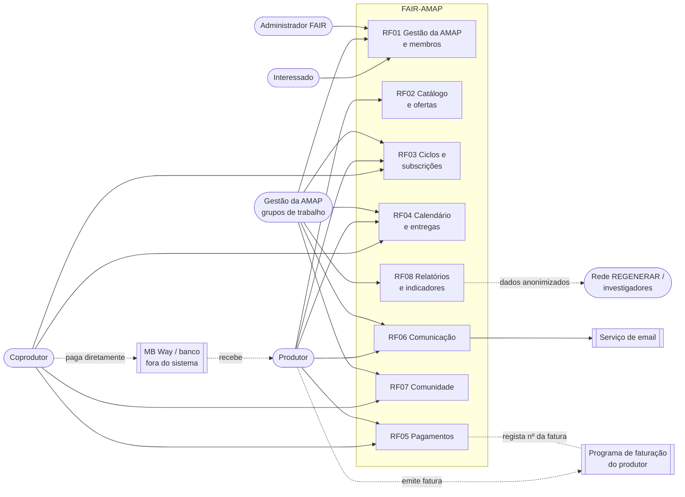

# Diagrama de contexto e atores

**Atualizado em:** 14/10/2026 · Secção do SRS: 2.1 Product perspective

Mostra quem usa a FAIR-AMAP, que funcionalidades usa cada ator e com que sistemas externos a plataforma comunica. Os pagamentos e as faturas ficam **fora do sistema**, segundo a proposta de âmbito C6 (a validar).

**Imagem (para o SRS):** [imagens/DiagramaContextoPT.png](imagens/DiagramaContextoPT.png)

## Notas
- **Cobrança centralizada** (proposta do grupo de 21/10): o coprodutor faz um só pagamento através de um **prestador de pagamentos licenciado**, que o divide pelos produtores; o sistema calcula, pede e regista os pagamentos, mas não guarda o dinheiro (RF-PAG-02 a 04, RNF-RES-02).
- A **faturação está fora do âmbito** (E-6): cada produtor emite as faturas no seu próprio programa (RNF-RES-01).
- A **gestão da AMAP** pode ser uma pessoa, uma comissão ou vários grupos de trabalho voluntários (D-C §4.5).
