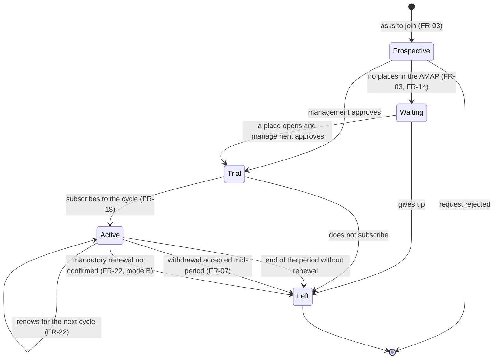
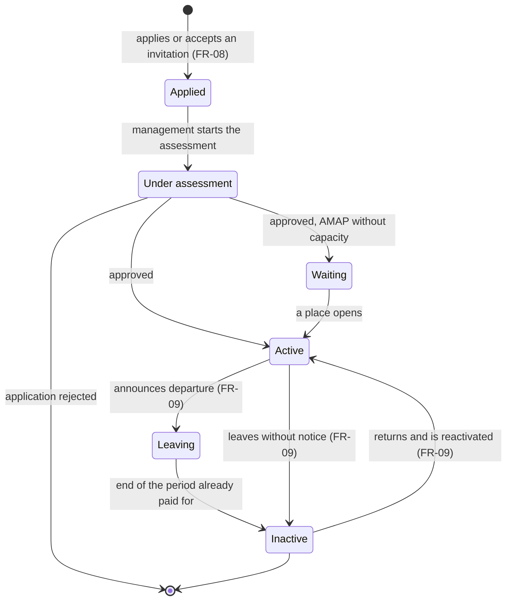
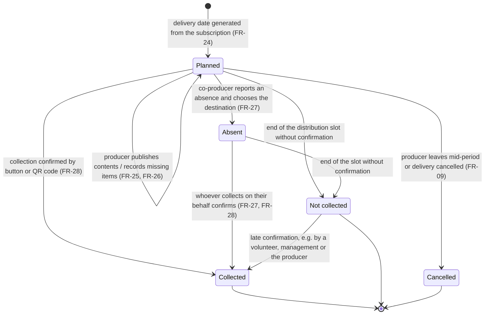

# State diagrams – member and delivery

**Owner:** João Mata · **Updated on:** 13/11/2026 · **SRS section:** Appendix – Analysis models
**Sources:** FR-03, FR-07, FR-08, FR-09, FR-22 in [RF01_GestaoAMAPMembrosEN.md](../RF01_GestaoAMAPMembrosEN.md) and [RF03_CiclosSubscricoesEN.md](../RF03_CiclosSubscricoesEN.md) · FR-26 to FR-29 in [RF04_CalendarioEntregasEN.md](../RF04_CalendarioEntregasEN.md) · [E-8](../../interviews/10-11-2026/Entrevista10_11EN.md) §2.3, §2.4, §2.7 · [domain model](ModeloDominioEN.md)

The states are those of the attribute `status` in the [domain model](ModeloDominioEN.md) and in the data dictionary (section 4.2). Each diagram describes **one membership in one AMAP**: a person who belongs to several AMAPs has one state in each (FR-07, NFR-22).

## 1. Co-producer membership

**Image (for the SRS):** [imagens/EstadosCoprodutorEN.png](imagens/EstadosCoprodutorEN.png)

*Table – States of a co-producer membership*

| State | Meaning | Main rules |
|---|---|---|
| Prospective | Has asked to join; waiting for management's decision | If there are no places, goes to the waiting list; otherwise management approves or rejects (FR-03, 3.1) |
| Waiting | There are no places in the AMAP | Ordered by arrival; management may change the order, recording the reason; notified when a place opens (FR-03, FR-14) |
| Trial | Receives the trial deliveries configured by the AMAP | Number of trial deliveries configured per AMAP (FR-03, DV-01) |
| Active | Has a confirmed subscription in the current cycle | Can belong to other AMAPs at the same time (FR-07) |
| Left | No longer a member of that AMAP | Data kept until the person asks for deletion or the retention period ends (FR-05, NFR-08) |

**Notes**
- **Leaving mid-period** is an exception: the rule is to leave at the end of the subscription period. If the AMAP accepts the withdrawal, the remaining deliveries are refunded and the producers are notified to stop delivering (E-8 §2.4). What happens if it is refused depends on the AMAP (to confirm, E-8).
- **Renewal mode B** (mandatory confirmation by a deadline) is chosen per AMAP; whoever does not confirm loses their place to the waiting list (FR-22, to validate DV-12).
- The transitions "gives up" and "does not subscribe" are **group assumptions**.

## 2. Producer membership

**Image (for the SRS):** [imagens/EstadosProdutorEN.png](imagens/EstadosProdutorEN.png)

*Table – States of a producer membership*

| State | Meaning | Main rules |
|---|---|---|
| Applied | Application submitted, with details and documents | Fields: name, location, main products, farming method, documents (E-8 §2.1) |
| Under assessment | Management assesses the application; a farm visit is typical | The visit is recorded if it takes place (FR-08) |
| Waiting | Approved, but the AMAP has no capacity | Notified when a place opens (3.1, use case "Apply to an AMAP") |
| Active | Delivers to the AMAP | States the dates and products they can deliver (FR-08, FR-24, FR-11) |
| Leaving | Has announced their departure with the notice set by the AMAP | Keeps delivering until the end of the period already paid for (FR-09) |
| Inactive | No longer appears in new cycles, catalogue or calendar | Future charges cancelled; profile and history kept; can be reactivated; stays active in other AMAPs (FR-09) |

**Notes**
- **Leaving without notice** (mid-period): the planned deliveries are cancelled and accounts must be settled. The system calculates what each co-producer paid and did not receive; other producers may compensate voluntarily, or management asks the producer for a refund (FR-09, E-8 §2.3).
- The states "Applied" and "Under assessment" correspond to the application statuses submitted and under assessment in the data dictionary (4.2.1).

## 3. Delivery

A delivery is what one co-producer receives on one delivery date (domain model: DELIVERY).

**Image (for the SRS):** [imagens/EstadosEntregaEN.png](imagens/EstadosEntregaEN.png)

*Table – States of a delivery*

| State | Meaning | Main rules |
|---|---|---|
| Planned | The delivery is scheduled for the date | The producer publishes the contents, confirms availability and records missing items and actual weights (FR-25, FR-26) |
| Absent | The co-producer reported an absence | The basket is always collected and paid for; the destination is chosen from the AMAP's list (friend, donation, sharing, raffle…); the producer is notified (FR-27) |
| Collected | Collection confirmed | By the in-app button (mandatory way, E-8) or, if the producer printed QR labels, by scanning the bag's QR code; a volunteer, management or the producer can confirm on behalf of someone without a phone (FR-28) |
| Not collected | The slot ended with no confirmation | The system flags the basket and notifies the co-producer and the producer (FR-28) |
| Cancelled | The delivery will not take place | Refund or compensation is handled as in FR-09 (E-8 §2.3) |

**Notes**
- **Missing items** do not change the state of the delivery: they are recorded per item (DELIVERED_ITEM) and compensated by a discount or a substitution (FR-26).
- The transition **Not collected → Collected** (late confirmation) is a **group assumption**: FR-28 says the system asks those who have not confirmed to do so after the slot.
