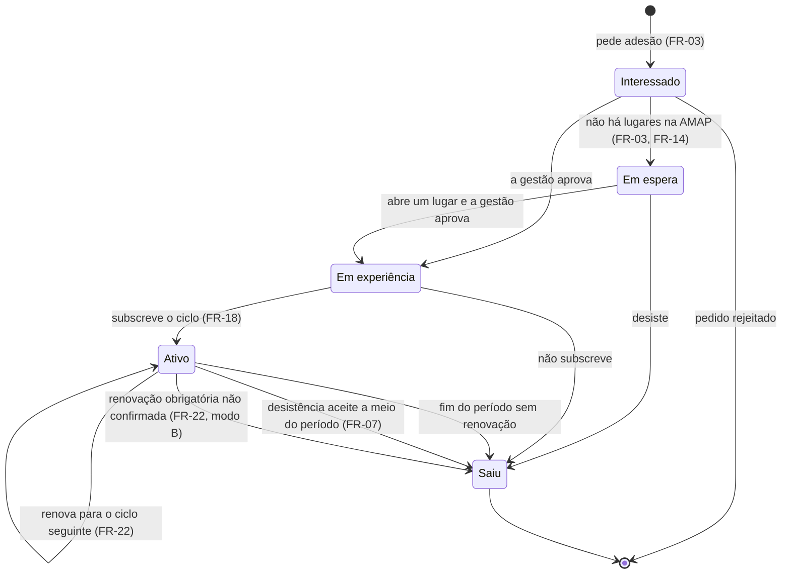
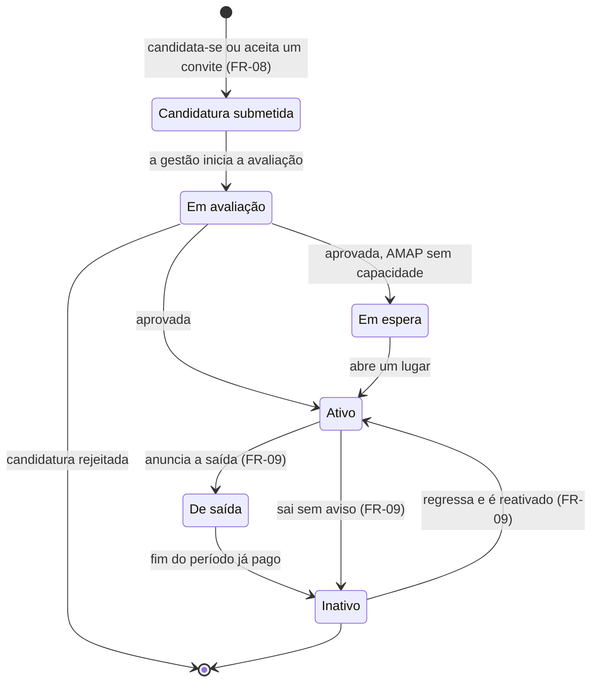
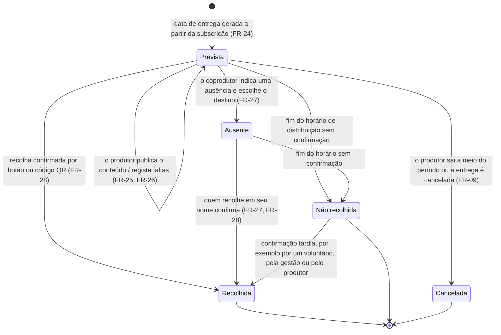

# Diagramas de estados – membro e entrega

**Responsável:** João Mata · **Atualizado em:** 13/11/2026 · **Secção do SRS:** Apêndice – Modelos de análise
**Fontes:** FR-03, FR-07, FR-08, FR-09, FR-22 em [RF01_GestaoAMAPMembrosPT.md](../RF01_GestaoAMAPMembrosPT.md) e [RF03_CiclosSubscricoesPT.md](../RF03_CiclosSubscricoesPT.md) · FR-26 a FR-29 em [RF04_CalendarioEntregasPT.md](../RF04_CalendarioEntregasPT.md) · [E-8](../../interviews/10-11-2026/Entrevista10_11PT.md) §2.3, §2.4, §2.7 · [modelo de domínio](ModeloDominioPT.md)

Os estados são os do atributo `status` do [modelo de domínio](ModeloDominioPT.md) e do dicionário de dados (secção 4.2). Cada diagrama descreve **uma adesão a uma AMAP**: uma pessoa que pertence a várias AMAP tem um estado em cada uma (FR-07, NFR-22).

## 1. Adesão de um coprodutor

**Imagem (para o SRS):** [imagens/EstadosCoprodutorPT.png](imagens/EstadosCoprodutorPT.png)

*Tabela – Estados da adesão de um coprodutor*

| Estado | Significado | Regras principais |
|---|---|---|
| Interessado | Pediu para aderir; aguarda a decisão da gestão | Se não houver lugares, vai para a lista de espera; caso contrário, a gestão aprova ou rejeita (FR-03, 3.1) |
| Em espera | Não há lugares na AMAP | Por ordem de chegada; a gestão pode mudar a ordem, registando o motivo; é avisado quando abre um lugar (FR-03, FR-14) |
| Em experiência | Recebe as entregas experimentais definidas pela AMAP | Número de entregas experimentais configurado por AMAP (FR-03, DV-01) |
| Ativo | Tem uma subscrição confirmada no ciclo atual | Pode pertencer a outras AMAP ao mesmo tempo (FR-07) |
| Saiu | Já não é membro dessa AMAP | Dados guardados até a pessoa pedir que sejam apagados ou até ao fim do prazo de conservação (FR-05, NFR-08) |

**Notas**
- **Sair a meio do período** é uma exceção: a regra é sair no fim do período de subscrição. Se a AMAP aceitar a desistência, as entregas que faltam são devolvidas e os produtores são avisados para deixar de entregar (E-8 §2.4). O que acontece se for recusada depende da AMAP (a confirmar, E-8).
- **O modo de renovação B** (confirmação obrigatória até um prazo) é escolhido por AMAP; quem não confirma perde o lugar para a lista de espera (FR-22, a validar DV-12).
- As transições "desiste" e "não subscreve" são **pressupostos do grupo**.

## 2. Adesão de um produtor

**Imagem (para o SRS):** [imagens/EstadosProdutorPT.png](imagens/EstadosProdutorPT.png)

*Tabela – Estados da adesão de um produtor*

| Estado | Significado | Regras principais |
|---|---|---|
| Candidatura submetida | Candidatura enviada, com dados e documentos | Campos: nome, localização, produtos principais, modo de produção, documentos (E-8 §2.1) |
| Em avaliação | A gestão avalia a candidatura; é habitual uma visita à quinta | A visita é registada se acontecer (FR-08) |
| Em espera | Aprovado, mas a AMAP não tem capacidade | Avisado quando abre um lugar (3.1, caso de uso "Candidatar-se a uma AMAP") |
| Ativo | Entrega à AMAP | Indica as datas e os produtos que pode entregar (FR-08, FR-24, FR-11) |
| De saída | Anunciou a saída com o aviso prévio definido pela AMAP | Continua a entregar até ao fim do período já pago (FR-09) |
| Inativo | Já não aparece em novos ciclos, no catálogo nem no calendário | Cobranças futuras canceladas; perfil e histórico guardados; pode ser reativado; continua ativo noutras AMAP (FR-09) |

**Notas**
- **Saída sem aviso** (a meio do período): as entregas previstas são canceladas e as contas têm de ser acertadas. O sistema calcula o que cada coprodutor pagou e não recebeu; outros produtores podem compensar de forma voluntária, ou a gestão pede a devolução ao produtor (FR-09, E-8 §2.3).
- Os estados "Candidatura submetida" e "Em avaliação" correspondem aos estados submetida e em avaliação da candidatura no dicionário de dados (4.2.1).

## 3. Entrega

Uma entrega é o que um coprodutor recebe numa data de entrega (modelo de domínio: DELIVERY).

**Imagem (para o SRS):** [imagens/EstadosEntregaPT.png](imagens/EstadosEntregaPT.png)

*Tabela – Estados de uma entrega*

| Estado | Significado | Regras principais |
|---|---|---|
| Prevista | A entrega está marcada para a data | O produtor publica o conteúdo, confirma a disponibilidade e regista faltas e pesos reais (FR-25, FR-26) |
| Ausente | O coprodutor indicou uma ausência | O cabaz é sempre recolhido e pago; o destino é escolhido da lista da AMAP (amigo, doação, partilha, sorteio…); o produtor é avisado (FR-27) |
| Recolhida | Recolha confirmada | Pelo botão na app (forma obrigatória, E-8) ou, se o produtor imprimiu etiquetas com QR, lendo o código QR do saco; um voluntário, a gestão ou o produtor podem confirmar por quem não tem telemóvel (FR-28) |
| Não recolhida | O horário terminou sem confirmação | O sistema assinala o cabaz e avisa o coprodutor e o produtor (FR-28) |
| Cancelada | A entrega não vai acontecer | A devolução ou compensação segue o FR-09 (E-8 §2.3) |

**Notas**
- **As faltas** não mudam o estado da entrega: são registadas por produto (DELIVERED_ITEM) e compensadas com desconto ou substituição (FR-26).
- A transição **Não recolhida → Recolhida** (confirmação tardia) é um **pressuposto do grupo**: o FR-28 diz que, depois do horário, o sistema pede a quem não confirmou que o faça.
