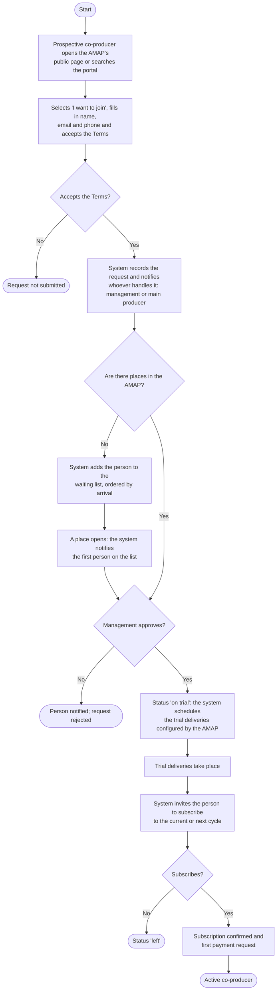
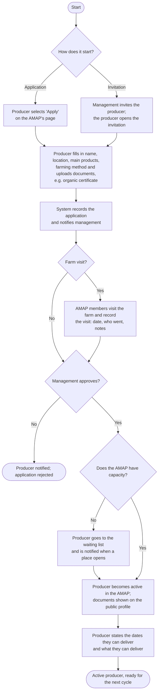
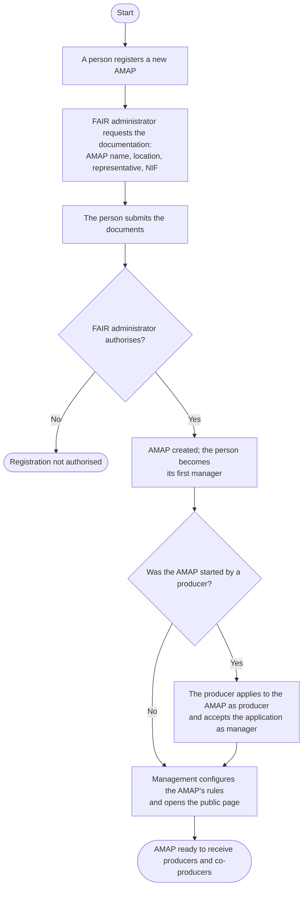

# Joining flow – co-producers and producers

**Owner:** João Mata · **Updated on:** 13/11/2026 · **SRS section:** Appendix – Analysis models
**Sources:** FR-01 to FR-08 and FR-14 in [RF01_GestaoAMAPMembrosEN.md](../RF01_GestaoAMAPMembrosEN.md) · [3.1](../../srs/3.1_AMAPMemberManagementEN.md) · [E-8](../../interviews/10-11-2026/Entrevista10_11EN.md) §1.3, §2.1, §2.2

These activity diagrams show the path of a person from the first contact until they are an active member of an AMAP. They complement the use cases "Request to join" (FR-03) and "Apply to an AMAP" (FR-08) of section 3.1. The states reached in each flow are detailed in the [state diagrams](DiagramasEstadoEN.md).

## 1. Co-producer joining

**Image (for the SRS):** [imagens/FluxoAdesaoCoprodutorEN.png](imagens/FluxoAdesaoCoprodutorEN.png)

**Notes**
- **Places exist at two levels:** the AMAP's maximum capacity and the number of co-producers each producer accepts per product (E-8 §2.2, FR-14).
- **The number of trial deliveries** is configured per AMAP (e.g. 1 or 2), which resolves the difference between E-4 and D-C (DV-01).
- **Management may change the order of the waiting list**, recording the reason (group decision of 21/10, FR-03).
- What happens when a person does not subscribe after the trial is a **group assumption**; it was not discussed with the client.

## 2. Producer joining

**Image (for the SRS):** [imagens/FluxoAdesaoProdutorEN.png](imagens/FluxoAdesaoProdutorEN.png)

**Notes**
- An **invited** producer is invited to apply, with the selection practically made (E-8 §2.1).
- The **farm visit** is typical but not mandatory; the process may vary between AMAPs, but there is always a producer registration (E-8 §2.1).
- A producer can be in **several AMAPs**; each application is separate (E-8 §2.1, NFR-22).

## 3. AMAP joining the platform (context)

The producer and co-producer flows assume the AMAP already exists. When it does not, the AMAP is registered first.

**Image (for the SRS):** [imagens/FluxoAdesaoAMAPEN.png](imagens/FluxoAdesaoAMAPEN.png)

**Note:** an AMAP started by a producer holds both the management and producer roles (E-8 §2.1, FR-06).
