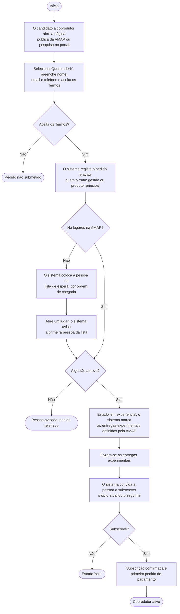
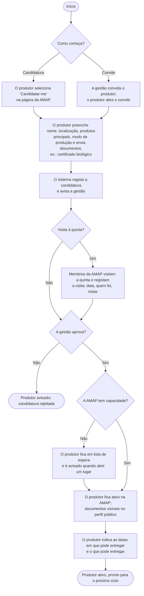
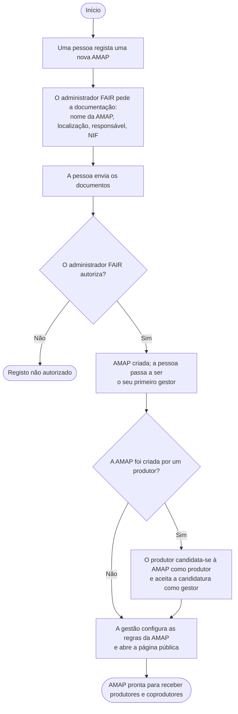

# Fluxo de adesão – coprodutores e produtores

**Responsável:** João Mata · **Atualizado em:** 13/11/2026 · **Secção do SRS:** Apêndice – Modelos de análise
**Fontes:** FR-01 a FR-08 e FR-14 em [RF01_GestaoAMAPMembrosPT.md](../RF01_GestaoAMAPMembrosPT.md) · [3.1](../../srs/3.1_AMAPMemberManagementEN.md) · [E-8](../../interviews/10-11-2026/Entrevista10_11PT.md) §1.3, §2.1, §2.2

Estes diagramas de atividades mostram o percurso de uma pessoa desde o primeiro contacto até ser membro ativo de uma AMAP. Complementam os casos de uso "Pedir adesão" (FR-03) e "Candidatar-se a uma AMAP" (FR-08) da secção 3.1. Os estados alcançados em cada fluxo estão detalhados nos [diagramas de estados](DiagramasEstadoPT.md).

## 1. Adesão de um coprodutor

**Imagem (para o SRS):** [imagens/FluxoAdesaoCoprodutorPT.png](imagens/FluxoAdesaoCoprodutorPT.png)

**Notas**
- **Os lugares existem a dois níveis:** a capacidade máxima da AMAP e o número de coprodutores que cada produtor aceita por produto (E-8 §2.2, FR-14).
- **O número de entregas experimentais** é configurado por AMAP (ex.: 1 ou 2), o que resolve a diferença entre a E-4 e o D-C (DV-01).
- **A gestão pode mudar a ordem da lista de espera**, registando o motivo (decisão do grupo de 21/10, FR-03).
- O que acontece quando uma pessoa não subscreve depois da experiência é um **pressuposto do grupo**; não foi discutido com o cliente.

## 2. Adesão de um produtor

**Imagem (para o SRS):** [imagens/FluxoAdesaoProdutorPT.png](imagens/FluxoAdesaoProdutorPT.png)

**Notas**
- Um produtor **convidado** é convidado a candidatar-se, com a seleção praticamente feita (E-8 §2.1).
- A **visita à quinta** é habitual mas não obrigatória; o processo pode variar entre AMAP, mas há sempre um registo do produtor (E-8 §2.1).
- Um produtor pode estar em **várias AMAP**; cada candidatura é separada (E-8 §2.1, NFR-22).

## 3. Adesão de uma AMAP à plataforma (contexto)

Os fluxos do produtor e do coprodutor partem do princípio de que a AMAP já existe. Quando não existe, a AMAP é registada primeiro.

**Imagem (para o SRS):** [imagens/FluxoAdesaoAMAPPT.png](imagens/FluxoAdesaoAMAPPT.png)

**Nota:** numa AMAP criada por um produtor, este fica com os papéis de gestão e de produtor (E-8 §2.1, FR-06).
