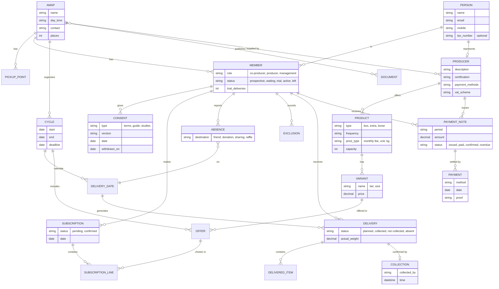

# Domain model

**Updated on:** 14/10/2026 · SRS sections: 4.1 Logical data model · 5 Domain model

First version, based on the entities identified in the [document analysis](../../tecnicas/ResultadosAnaliseDocumentalEN.md) (§3) and on requirements RF01–RF08. It shows only the entities, relationships and main attributes. The full data dictionary is left for SRS section 4.2.

**Image (for the SRS):** [imagens/ModeloDominioEN.png](imagens/ModeloDominioEN.png)

## Notes
- **PERSON** and **MEMBER** are separate because the same person can be a member of several AMAPs with different roles (RF-MEM-01, RF-MEM-06).
- **OFFER** links a product/variant to a cycle and stores that cycle's price and capacity. This allows reusing the catalogue across cycles (RF-CAT-01).
- The **payment note** is per producer and per co-producer, because each producer is paid directly (RF-PAG-03).
- Still missing: working groups, rotas, events and indicators (RF07, RF08).
