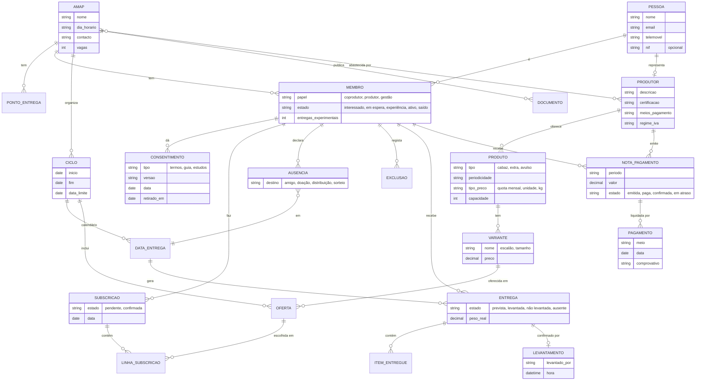

# Modelo de domínio

**Atualizado em:** 14/10/2026 · Secções do SRS: 4.1 Logical data model · 5 Domain model

Primeira versão, a partir das entidades identificadas na [análise documental](../../tecnicas/ResultadosAnaliseDocumentalPT.md) (§3) e dos requisitos RF01–RF08. Mostra só as entidades, as relações e os atributos principais. O dicionário de dados completo fica para a secção 4.2 do SRS.

**Imagem (para o SRS):** [imagens/ModeloDominioPT.png](imagens/ModeloDominioPT.png)

## Notas
- **PESSOA** e **MEMBRO** estão separados porque a mesma pessoa pode ser membro de várias AMAP com papéis diferentes (RF-MEM-01, RF-MEM-06).
- **OFERTA** liga um produto/variante a um ciclo e guarda o preço e a capacidade desse ciclo. Permite reutilizar o catálogo entre ciclos (RF-CAT-01).
- A **nota de pagamento** é por produtor e por coprodutor, porque cada produtor recebe diretamente (RF-PAG-03).
- Ainda faltam: grupos de trabalho, escalas, eventos e indicadores (RF07, RF08).
