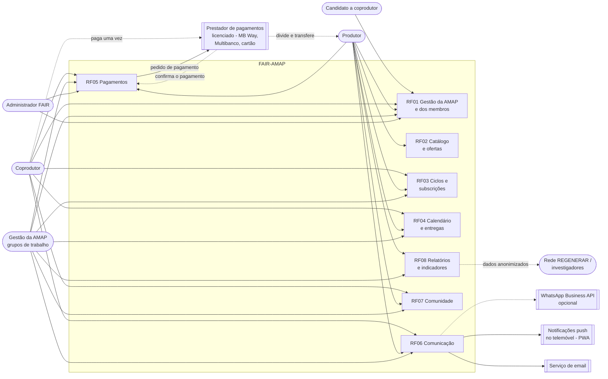

# 2.1 Perspetiva do produto

**Responsável:** João Mata · **Atualizado em:** 13/11/2026 · **Estado:** Pronto ·
**Fontes:** [diagrama de contexto](../requisitos/diagramas/DiagramaContextoPT.md) · [2.4](2.4_RestricoesConcecaoImplementacaoPT.md) · [E-8](../interviews/10-11-2026/Entrevista10_11PT.md) · RF01–RF08 em [requisitos/](../requisitos/README.md)

A FAIR-AMAP é um **produto novo e autónomo**. Não é uma nova versão de um sistema existente nem um módulo de um sistema maior. É uma **plataforma web partilhada por várias AMAP** (NFR-22), disponibilizada e mantida pela FAIR (NFR-23), em que cada AMAP mantém os seus dados e as suas regras de funcionamento (NFR-24, E-8).

O produto **substitui um conjunto de ferramentas genéricas** que a AMAP Porto usa hoje, sem ligação entre si e sem registo do estado de cada membro:

*Tabela – Ferramentas atuais e a funcionalidade da FAIR-AMAP que as substitui*

| Hoje | Problema | Substituído por |
|---|---|---|
| Contacto direto com o produtor principal para aderir; Google Forms para os dados pessoais | Não há registo do estado de cada pessoa (interessada, em espera, em experiência, ativa) | 3.1 Gestão da AMAP e dos membros (RF01) |
| Google Form com o catálogo e a encomenda; cópia por email guardada pelo coprodutor | As opções acabam em texto livre; o coprodutor tem de guardar o email para se lembrar do que encomendou | 3.2 Catálogo e ofertas (RF02), 3.3 Ciclos e subscrições (RF03) |
| Conteúdo do cabaz, ausências e faltas combinados por WhatsApp | Mensagens dispersas; sem confirmação de recolha; cabazes deixados fora depois do horário de distribuição | 3.4 Calendário e entregas (RF04), 3.6 Comunicação (RF06) |
| Cada produtor recebe diretamente, com meios e momentos próprios; contas feitas em Excel e enviadas por mensagem | O coprodutor não tem forma simples de saber quanto deve | 3.5 Pagamentos (RF05) |
| Documentos da AMAP (Termos, Guia, Carta de Princípios) difíceis de encontrar; trabalho voluntário organizado de forma informal | Os documentos existem mas são difíceis de encontrar | 3.7 Comunidade (RF07) |
| Ficheiros Excel para planear e fazer contas | Trabalho manual em cada ciclo | 3.3 (FR-23) e 3.8 Relatórios e indicadores (RF08) |

## 2.1.1 Diagrama de contexto

O diagrama mostra quem usa a FAIR-AMAP, que funcionalidades cada ator usa e com que sistemas externos a plataforma comunica.

*[Figura: `docs/requisitos/diagramas/imagens/DiagramaContextoPT.png`]*
*Figura – Diagrama de contexto e atores da FAIR-AMAP*

**Alterações à versão de 28/10 do diagrama:** o ator passa a chamar-se *candidato a coprodutor*, como na secção 3.1; o produtor também usa o RF01 (candidatura a uma AMAP, FR-08, E-8), o RF07 (eventos, FR-41) e o RF08 (exportação das encomendas, FR-42); o coprodutor também usa o RF01 (registo, consentimentos, saída) e o RF06 (mensagens com o produtor, FR-37); a gestão também usa o RF05 (acompanhamento dos pagamentos, FR-33); o WhatsApp foi acrescentado como canal **opcional** (FR-38).

## 2.1.2 Utilizadores do sistema

As classes de utilizadores são descritas na secção 2.2. Aqui só se indica a sua relação com o produto.

*Tabela – Atores do diagrama de contexto*

| Ator | Relação com a FAIR-AMAP |
|---|---|
| Candidato a coprodutor | Encontra uma AMAP pela sua página pública ou pelo portal e pede para aderir (FR-02, FR-03). |
| Coprodutor | Subscreve os produtos de cada ciclo, recolhe o cabaz, paga uma vez por período e participa na vida comunitária da AMAP. |
| Produtor | Candidata-se a uma AMAP, gere o catálogo, publica o conteúdo dos cabazes, regista faltas e pesos reais e recebe o resumo dos pagamentos. Pode pertencer a várias AMAP (NFR-22). |
| Gestão da AMAP | Uma pessoa, uma comissão ou vários grupos de trabalho voluntários (D-C §4.5). Configura as regras da AMAP, aprova membros e produtores e organiza ciclos, entregas e voluntários. |
| Administrador FAIR | Atua só ao nível da plataforma: autoriza o registo de uma nova AMAP depois de verificar os documentos, atribui o primeiro gestor, dá apoio e configura o valor cobrado pela FAIR (FR-06, FR-34, E-8). |
| Rede REGENERAR / investigadores | Não usam a plataforma; recebem dados anonimizados ou de membros que deram consentimento (FR-44). |

## 2.1.3 Sistemas externos e interfaces

*Tabela – Sistemas externos com que a FAIR-AMAP comunica*

| Sistema externo | Sentido | O que é trocado | Requisitos |
|---|---|---|---|
| Prestador de pagamentos licenciado (ex.: MB Way, referência Multibanco, cartão) | Nos dois sentidos | A FAIR-AMAP envia o pedido de pagamento; o prestador cobra o pagamento único do coprodutor, confirma-o e divide-o pelas contas dos produtores | FR-30, FR-32, NFR-19 |
| Serviço de email | Saída | Notificações, lembretes, avisos e pedidos de pagamento | FR-35, FR-38, NFR-15 |
| Notificações push (PWA) | Saída | As mesmas notificações, para quem as ativar | FR-38, NFR-15 |
| WhatsApp Business API (opcional) | Saída | Notificações individuais, só através da API oficial | FR-38 |

A plataforma também **produz ficheiros** usados fora dela, mas estes não são interfaces com outros sistemas: PDF A4 para imprimir (folha de distribuição e etiquetas dos sacos, FR-29) e exportações CSV/XLSX (FR-10, FR-42, FR-44, NFR-16). O detalhe de todas as interfaces está na secção 6.

## 2.1.4 Limites do produto

O que a FAIR-AMAP **não faz** é tão importante como o que faz, porque define o seu lugar em relação a outros sistemas:

- **Não emite faturas.** Cada produtor continua a faturar no seu próprio programa (NFR-18, E-6).
- **Não guarda dinheiro.** Calcula, pede e regista os pagamentos; é o prestador licenciado que movimenta o dinheiro (NFR-19, aceite pela FAIR na E-8).
- **Não é um intermediário comercial.** É uma ferramenta de organização; o produtor define o preço e o contacto direto entre produtor e coprodutor continua visível (NFR-20).
- **Não obriga a instalar uma app de uma loja.** É uma aplicação web para telemóvel e computador, que pode ser instalada no ecrã inicial como PWA (NFR-01).

As restrições por trás destes limites estão na secção 2.4.
