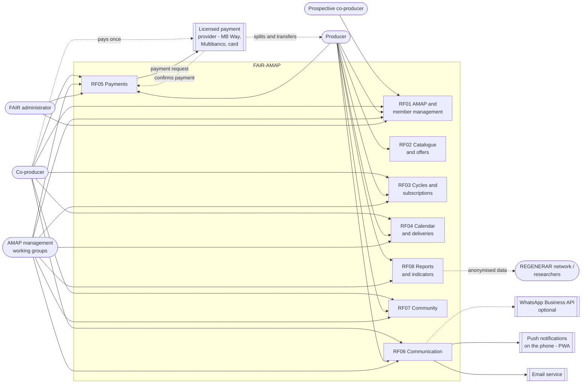

# 2.1 Product perspective

**Owner:** João Mata · **Updated on:** 13/11/2026 · **Status:** Ready ·
**Sources:** [context diagram](../requisitos/diagramas/DiagramaContextoEN.md) · [2.4](2.4_RestricoesConcecaoImplementacaoEN.md) · [E-8](../interviews/10-11-2026/Entrevista10_11EN.md) · RF01–RF08 in [requisitos/](../requisitos/README.md)

FAIR-AMAP is a **new, self-contained product**. It is not a new version of an existing system and it is not a module of a larger system. It is a **web platform shared by several AMAPs** (NFR-22), offered and maintained by FAIR (NFR-23), in which each AMAP keeps its own data and its own operating rules (NFR-24, E-8).

The product **replaces a set of general-purpose tools** that AMAP Porto uses today, with no link between them and no record of each member's status:

*Table – Current tools and the feature of FAIR-AMAP that replaces them*

| Today | Problem | Replaced by |
|---|---|---|
| Direct contact with the main producer to join; Google Forms for personal data | No record of each person's status (prospective, waiting, trial, active) | 3.1 AMAP and member management (RF01) |
| Google Form with the catalogue and the order; email copy kept by the co-producer | Options end up as free text; the co-producer has to keep the email to remember what they ordered | 3.2 Catalogue and offers (RF02), 3.3 Cycles and subscriptions (RF03) |
| Basket contents, absences and missing items arranged through WhatsApp | Scattered messages; no collection confirmation; baskets left outside after the distribution slot | 3.4 Calendar and deliveries (RF04), 3.6 Communication (RF06) |
| Each producer paid directly, with their own methods and timing; amounts calculated in Excel and sent by message | The co-producer has no simple way to know how much they owe | 3.5 Payments (RF05) |
| AMAP documents (Terms, Guide, Charter of Principles) hard to find; volunteer work organised informally | Documents exist but are hard to find | 3.7 Community (RF07) |
| Excel files for planning and calculations | Manual work for each cycle | 3.3 (FR-23) and 3.8 Reports and indicators (RF08) |

## 2.1.1 Context diagram

The diagram shows who uses FAIR-AMAP, which features each actor uses and which external systems the platform communicates with.

*[Figure: `docs/requisitos/diagramas/imagens/DiagramaContextoEN.png`]*
*Figure – Context and actors diagram of FAIR-AMAP*

**Changes to the 28/10 version of the diagram:** the actor is now called *prospective co-producer*, as in section 3.1; the producer also uses RF01 (application to an AMAP, FR-08, E-8), RF07 (events, FR-41) and RF08 (export of orders, FR-42); the co-producer also uses RF01 (registration, consents, departure) and RF06 (messages with the producer, FR-37); management also uses RF05 (payment tracking, FR-33); WhatsApp was added as an **optional** channel (FR-38).

## 2.1.2 Users of the system

The user classes are described in section 2.2. Here they are only listed by their relation to the product.

*Table – Actors in the context diagram*

| Actor | Relation to FAIR-AMAP |
|---|---|
| Prospective co-producer | Finds an AMAP through its public page or the portal and asks to join (FR-02, FR-03). |
| Co-producer | Subscribes to each cycle's products, collects the basket, pays once per period and takes part in the AMAP's community life. |
| Producer | Applies to an AMAP, manages the catalogue, publishes basket contents, records missing items and actual weights, and receives the payment summary. May belong to several AMAPs (NFR-22). |
| AMAP management | One person, a committee or several volunteer working groups (D-C §4.5). Configures the AMAP's rules, approves members and producers, and organises cycles, deliveries and volunteers. |
| FAIR administrator | Acts only at platform level: authorises the registration of a new AMAP after checking its documents, assigns its first manager, provides support and configures FAIR's charges (FR-06, FR-34, E-8). |
| REGENERAR network / researchers | Do not use the platform; they receive anonymised data or data from members who gave consent (FR-44). |

## 2.1.3 External systems and interfaces

*Table – External systems that FAIR-AMAP communicates with*

| External system | Direction | What is exchanged | Requirements |
|---|---|---|---|
| Licensed payment provider (e.g. MB Way, Multibanco reference, card) | Both | FAIR-AMAP sends the payment request; the provider collects the co-producer's single payment, confirms it and splits it among the producers' accounts | FR-30, FR-32, NFR-19 |
| Email service | Outbound | Notifications, reminders, notices and payment requests | FR-35, FR-38, NFR-15 |
| Push notifications (PWA) | Outbound | The same notifications, for users who turn them on | FR-38, NFR-15 |
| WhatsApp Business API (optional) | Outbound | Individual notifications, only through the official API | FR-38 |

The platform also **produces files** that are used outside it, but these are not interfaces with other systems: printable A4 PDFs (distribution sheet and bag labels, FR-29) and CSV/XLSX exports (FR-10, FR-42, FR-44, NFR-16). The detail of all interfaces is in section 6.

## 2.1.4 Product boundaries

What FAIR-AMAP **does not do** is as important as what it does, because it defines the product's place in relation to other systems:

- **It does not issue invoices.** Each producer keeps issuing invoices in their own software (NFR-18, E-6).
- **It does not hold money.** It calculates, requests and records payments; the licensed provider moves the money (NFR-19, accepted by FAIR in E-8).
- **It is not a commercial intermediary.** It is an organisation tool; the producer sets the price and direct contact between producer and co-producer remains visible (NFR-20).
- **It does not require installing an app from a store.** It is a web application for mobile and desktop that can be installed on the home screen as a PWA (NFR-01).

The constraints behind these limits are in section 2.4.
