# 4 Data requirements

**Owner:** João Mata · **Updated on:** 13/11/2026 · **Status:** Ready · 
**Sources:** [logical data model](../requisitos/diagramas/ModeloDominioEN.md) · RF01–RF08 in [requisitos/](../requisitos/README.md) · [2.4](2.4_RestricoesConcecaoImplementacaoEN.md) · [E-8](../interviews/10-11-2026/Entrevista10_11EN.md)

This section describes the data that FAIR-AMAP stores and produces: the logical data model (4.1), the meaning and format of each data item (4.2), the reports the system generates (4.3) and the rules for acquiring, keeping and deleting data (4.4). The split of the model into bounded contexts is in section 5.

## 4.1 Logical data model

The main model is the [domain model](../requisitos/diagramas/ModeloDominioEN.md) (Figure: `docs/requisitos/diagramas/imagens/ModeloDominioEN.png`), with the entities of RF01 to RF05. Its notes said that working groups, rotas, events and indicators were still missing. The figure below **adds only the entities that were missing**, for the producer's application (FR-08), payments configuration (FR-30, FR-34), communication (RF06), community (RF07) and data exports (RF08). Entities already in the main model are shown without attributes.

*[Figure: `docs/requisitos/diagramas/imagens/ModeloDadosComplementarEN.png`]*
*Figure – Logical data model: entities added to the domain model*

```mermaid
erDiagram
    AMAP ||--o{ PRODUCER_APPLICATION : "receives"
    PRODUCER ||--o{ PRODUCER_APPLICATION : "submits"
    PRODUCER_APPLICATION ||--o{ APPLICATION_DOCUMENT : "includes"
    PRODUCER_APPLICATION ||--o| FARM_VISIT : "assessed by"
    MEMBER ||--o{ WITHDRAWAL_REQUEST : "asks"
    PERSON ||--o{ DATA_RIGHTS_REQUEST : "asks"
    AMAP ||--|| PAYMENT_SETTINGS : "configures"
    PRODUCER ||--o| PAYOUT_ACCOUNT : "receives in"
    AMAP ||--o{ FAIR_CHARGE : "is charged"
    PERSON ||--o{ NOTIFICATION : "receives"
    PERSON ||--o{ CHANNEL_PREFERENCE : "chooses"
    AMAP ||--o{ NOTICE : "publishes"
    PERSON ||--o{ MESSAGE : "sends"
    PRODUCER ||--o{ NEWS_POST : "publishes"
    NEWS_POST }o--o{ DELIVERED_ITEM : "explains missing"
    AMAP ||--o{ WORKING_GROUP : "has"
    WORKING_GROUP }o--o{ MEMBER : "includes"
    DELIVERY_DATE ||--o{ ROTA_SHIFT : "needs"
    ROTA_SHIFT ||--o{ SHIFT_SIGNUP : "filled by"
    MEMBER ||--o{ SHIFT_SIGNUP : "signs up"
    AMAP ||--o{ EVENT : "organises"
    EVENT ||--o{ EVENT_SIGNUP : "has"
    MEMBER ||--o{ EVENT_SIGNUP : "signs up"
    MEMBER ||--o{ FEEDBACK : "gives"
    DOCUMENT ||--o{ DOCUMENT_VERSION : "has"
    AMAP ||--o{ DATA_EXPORT : "records"

    PRODUCER_APPLICATION {
        string origin "application, invitation"
        string status "submitted, under assessment, approved, rejected, waiting list"
        string farming_method
        string main_products
    }
    FARM_VISIT {
        date date
        string visitors
        string notes
    }
    PAYMENT_SETTINGS {
        string methods "MB Way, Multibanco, card"
        date payment_deadline
    }
    PAYOUT_ACCOUNT {
        string provider_account_ref
    }
    FAIR_CHARGE {
        string period
        decimal minimum_fee
        decimal percentage
        decimal amount
    }
    NOTIFICATION {
        string type
        string channel "email, push, whatsapp"
        datetime sent_at
    }
    NEWS_POST {
        string text
        datetime published_at
    }
    ROTA_SHIFT {
        int places
        string task
    }
    EVENT {
        string type "farm visit, help day, workshop, social, assembly"
        datetime start
        string place
        int places
    }
    DOCUMENT_VERSION {
        string version
        date published_on
    }
    DATA_EXPORT {
        string purpose "producer report, studies, AMAP leaving, data subject"
        datetime created_at
        string created_by
    }
```

**Main rules of the model**
- **PERSON and MEMBER** are separate: the same person can be a member of several AMAPs, with different roles in each (FR-06, FR-07, NFR-22). The status (prospective, waiting, trial, active, left) belongs to the membership, not to the person.
- **Each AMAP's data is kept separate** (NFR-22). Every entity except PERSON and PRODUCER belongs to exactly one AMAP.
- **The payment note** is per co-producer and period, broken down by producer; it is settled by one or more payments (FR-31, FR-32). The system stores only the provider's reference for each payment, never card or account data of the co-producer (NFR-19).
- **Indicators** (FR-43) are **calculated** from subscriptions, deliveries and members when they are requested; they are not stored as an entity.

## 4.2 Data dictionary

Formats follow section 8: dates dd/mm/yyyy, Portuguese time zone, amounts in euros with VAT included (NFR-13, NFR-14). "Req." is the requirement where the item comes from. Items marked **(health data)** or **(personal data)** follow section 7 (NFR-04 to NFR-08).

### 4.2.1 AMAP and members (RF01)

*Table – Data dictionary: AMAP*

| Item | Description | Type / format | Values and rules | Req. |
|---|---|---|---|---|
| name | Name of the AMAP | Text, up to 100 characters | Mandatory | FR-01 |
| tax_number | AMAP's tax number (NIF) | 9 digits | Requested on registration (E-8) | FR-01 |
| representative | Person responsible for the AMAP | Reference to PERSON | Mandatory on registration (E-8) | FR-01 |
| location | Location of the AMAP | Text | Mandatory on registration (E-8) | FR-01 |
| day_time | Distribution day and time | Weekday + time slot (hh:mm–hh:mm) | Can change on specific dates (e.g. public holidays) | FR-24 |
| contact | Public contact | Email or phone | Shown on the public page | FR-01, FR-02 |
| places | Maximum number of co-producers | Whole number ≥ 1 | Depends on premises, transport and space (E-8) | FR-14 |
| rules | Operating rules | Set of settings | Cycle length, deadlines, number of trial deliveries, renewal mode, absence destinations, withdrawal rules | FR-01, NFR-24 |
| status | Registration status | List | pending authorisation, active, leaving, inactive | FR-01, FR-10 |

*Table – Data dictionary: PICKUP_POINT*

| Item | Description | Type / format | Values and rules | Req. |
|---|---|---|---|---|
| name | Name of the delivery point | Text | Mandatory | FR-24 |
| address | Address | Text | Mandatory | FR-24 |
| (Could) several points per AMAP | — | — | An AMAP can have several pick-up points | FR-24 |

*Table – Data dictionary: PERSON (personal data)*

| Item | Description | Type / format | Values and rules | Req. |
|---|---|---|---|---|
| name | Full name | Text, up to 100 characters | Mandatory | FR-04 |
| email | Email address | Valid email | Mandatory | FR-04 |
| mobile | Mobile phone | Portuguese or international number | Mandatory for co-producers | FR-04 |
| tax_number | Tax number (NIF) | 9 digits | **Optional**: only if the person wants an invoice with NIF (CIVA art. 40) | FR-04 |
| legal_age | Declaration of legal age | Yes/No | Mandatory to register | FR-05 |

*Table – Data dictionary: MEMBER (membership of a person in an AMAP)*

| Item | Description | Type / format | Values and rules | Req. |
|---|---|---|---|---|
| roles | Roles in the AMAP | List | co-producer, producer, management; one person may have several | FR-06 |
| status | Status of the membership | List | prospective, waiting, trial, active, left (see the state diagrams in the appendix) | FR-03, FR-07 |
| waiting_position | Position in the waiting list | Whole number | Ordered by arrival; management may change the order, recording the reason | FR-03 |
| trial_deliveries | Number of trial deliveries done | Whole number ≥ 0 | Limit configured per AMAP (e.g. 1 or 2) | FR-03 |
| joined_on / left_on | Dates of joining and leaving | Date | left_on is filled when the status becomes "left" | FR-03, FR-07 |
| leaving_reason | Reason for leaving | Text | Recorded when a co-producer leaves mid-subscription | FR-07 |

*Table – Data dictionary: CONSENT and DOCUMENT_VERSION*

| Item | Description | Type / format | Values and rules | Req. |
|---|---|---|---|---|
| CONSENT.type | What was accepted | List | terms, guide, studies | FR-05 |
| CONSENT.version | Version accepted | Reference to DOCUMENT_VERSION | Mandatory for terms and guide | FR-05, FR-39 |
| CONSENT.date / withdrawn_on | Date given and date withdrawn | Date | Optional consents (e.g. studies) can be withdrawn | FR-05 |
| DOCUMENT.type | AMAP document | List | Terms and Conditions, Guide, Charter of Principles, minutes, other | FR-39, FR-40 |
| DOCUMENT_VERSION.version / published_on | Version and publication date | Text / Date | Only the current version is shown; previous versions are kept | FR-39 |

*Table – Data dictionary: PRODUCER, PRODUCER_APPLICATION and FARM_VISIT*

| Item | Description | Type / format | Values and rules | Req. |
|---|---|---|---|---|
| PRODUCER.description | Public presentation of the producer and the farm | Text | Shown on the public profile | FR-04 |
| PRODUCER.location | Location of the farm | Text | Mandatory | FR-04, FR-08 |
| PRODUCER.farming_method | How they produce | Text | E.g. organic or not (E-8) | FR-08 |
| PRODUCER.certification | Certificates | Files (PDF or image) | Optional; e.g. organic certificate; visible to co-producers | FR-04, FR-08 |
| PRODUCER.capacity | Number of co-producers accepted | Whole number ≥ 1 | Per product and per AMAP (E-8) | FR-14 |
| PRODUCER_APPLICATION.origin | How the application started | List | application, invitation | FR-08 |
| PRODUCER_APPLICATION.main_products | Products that characterise the producer | Text | Mandatory | FR-08 |
| PRODUCER_APPLICATION.status | Status of the application | List | submitted, under assessment, approved, rejected, waiting list | FR-08 |
| FARM_VISIT.date / visitors / notes | Visit to the farm | Date / Text / Text | Optional; recorded if it takes place | FR-08 |

### 4.2.2 Catalogue, cycles and subscriptions (RF02, RF03)

*Table – Data dictionary: PRODUCT, VARIANT and OFFER*

| Item | Description | Type / format | Values and rules | Req. |
|---|---|---|---|---|
| PRODUCT.name / description | Name and details sheet | Text | Mandatory; no closed list of products | FR-11, FR-15 |
| PRODUCT.type | Kind of product | List | basket, extra, one-off | FR-11 |
| PRODUCT.price_type | How it is priced | List | fixed fee, per unit, per kg | FR-13 |
| PRODUCT.frequency | How often it is delivered | Text or list | E.g. weekly, fortnightly, monthly, only in certain months | FR-13 |
| PRODUCT.capacity | Maximum co-producers for the product | Whole number ≥ 1 | Cannot exceed the AMAP's places; when reached, waiting list | FR-14 |
| VARIANT.name | Variant or size | Text | E.g. size, price level | FR-12 |
| VARIANT.price | Price | Euros with VAT, 2 decimals | > 0 | FR-13, NFR-14 |
| OFFER.price / capacity | Price and capacity in a given cycle | Euros / Whole number | Lets the catalogue be reused between cycles | FR-11 |
| OFFER.available_quantity | Quantity of a one-off offer | Decimal ≥ 0 | The offer closes when it reaches 0 or at the deadline | FR-16 |

*Table – Data dictionary: CYCLE, DELIVERY_DATE, SUBSCRIPTION and EXCLUSION*

| Item | Description | Type / format | Values and rules | Req. |
|---|---|---|---|---|
| CYCLE.start / end | Start and end of the cycle | Date | Length configurable (e.g. 3, 6 or 12 months) | FR-17 |
| CYCLE.opening / deadline | Opening date and subscription deadline | Date | opening ≤ deadline; requests after the deadline stay pending | FR-17, FR-20 |
| DELIVERY_DATE.date | Delivery date of a producer | Date | Within the cycle and on the AMAP's distribution day | FR-24 |
| DELIVERY_DATE.mode | Delivery mode | List | labelled bag at the delivery point, hand delivery, route | FR-24 |
| SUBSCRIPTION.status | Status | List | pending (after the deadline, waiting for approval), confirmed | FR-18, FR-20 |
| SUBSCRIPTION_LINE.quantity / variant / dates | What was chosen | Number / Reference / Dates | Within the product's capacity | FR-18 |
| EXCLUSION.type | Kind of exclusion | List | allergy, intolerance, dislike | FR-19 |
| EXCLUSION.description | What is excluded | Text | **Allergies and intolerances are health data**: explicit consent; never printed on labels | FR-19, NFR-06 |
| EXCLUSION.substitution | Substitution made by the producer | Text | Recorded by the producer | FR-19 |

### 4.2.3 Deliveries (RF04)

*Table – Data dictionary: DELIVERY, DELIVERED_ITEM, ABSENCE and COLLECTION*

| Item | Description | Type / format | Values and rules | Req. |
|---|---|---|---|---|
| DELIVERY.status | Status of a co-producer's delivery on a date | List | planned, collected, not collected, absent, cancelled (see the state diagram in the appendix) | FR-27, FR-28, FR-09 |
| DELIVERED_ITEM.quantity / actual_weight | Quantity or weight actually delivered | Decimal ≥ 0 (units or kg) | Recorded by the producer (e.g. meat); used in the payment | FR-26, FR-31 |
| DELIVERED_ITEM.missing / compensation | Missing item and compensation given | Yes/No + Text | Compensation: discount or substitution in another delivery | FR-26 |
| ABSENCE.destination | What happens to the basket | List defined by the AMAP | friend or relative, donation, sharing, raffle… The basket is always collected and paid for | FR-27 |
| ABSENCE.collected_by | Who collects on the co-producer's behalf | Text | Optional | FR-27 |
| COLLECTION.method | How the collection was confirmed | List | app button, QR code, on behalf (volunteer, management or producer) | FR-28 |
| COLLECTION.collected_by / time | Who confirmed and when | Text / Date and time | Mandatory when collected | FR-28 |

### 4.2.4 Payments (RF05)

*Table – Data dictionary: PAYMENT_SETTINGS, PAYOUT_ACCOUNT, PAYMENT_NOTE, PAYMENT and FAIR_CHARGE*

| Item | Description | Type / format | Values and rules | Req. |
|---|---|---|---|---|
| PAYMENT_SETTINGS.methods | Methods available in the AMAP | List | MB Way, Multibanco reference, card (through the provider) | FR-30 |
| PAYMENT_SETTINGS.charge_moment | When each product is charged | List, per producer and product | in advance for the cycle, start of each month, after delivery or weighing | FR-30 |
| PAYOUT_ACCOUNT.provider_account_ref | Producer's account with the provider | Provider identifier | The system stores only the reference, not bank data | FR-30, NFR-19 |
| PAYMENT_NOTE.period | Period charged | Month or cycle | One note per co-producer and period | FR-31 |
| PAYMENT_NOTE.amount | Amount due | Euros, 2 decimals | = basket fees + extras + weighed products − compensated missing items; broken down by producer | FR-31 |
| PAYMENT_NOTE.status | Status | List | issued, paid, confirmed, overdue | FR-31, FR-33 |
| PAYMENT.method / date | Method and date of the payment | List / Date | Provider methods or "outside the platform" | FR-32 |
| PAYMENT.provider_ref | Provider's transaction reference | Text | Mandatory for payments through the provider | FR-32 |
| PAYMENT.recorded_by | Who recorded a manual payment | Reference to PERSON | Mandatory for payments outside the platform (e.g. cash) | FR-32 |
| PAYMENT.fee_deducted | Payment method fee deducted from the producer's share | Euros | Optional; shown in the producer's summary (E-8) | FR-32, FR-33 |
| FAIR_CHARGE.minimum_fee / percentage | FAIR's pricing model | Euros / % | Set by FAIR; may be zero during the pilot (E-8) | FR-34, NFR-21 |
| FAIR_CHARGE.amount | Amount charged to the AMAP in the period | Euros | = minimum fee + percentage × value of the payments to producers | FR-34 |

### 4.2.5 Communication and community (RF06, RF07)

*Table – Data dictionary: communication and community*

| Item | Description | Type / format | Values and rules | Req. |
|---|---|---|---|---|
| NOTIFICATION.type | Event notified | List | delivery reminder, cycle opening, new offer, basket contents, date change, availability or missing item, uncollected basket, payment request, notice, news | FR-35 |
| CHANNEL_PREFERENCE.channel | Channels chosen by the user | List | email, push, WhatsApp (optional) | FR-38, NFR-15 |
| NOTICE.recipients | Who receives a notice | List | all members, co-producers, producers, a working group | FR-36 |
| MESSAGE.text | Message between producer and co-producer | Text | Personal data; visible only to sender and receivers | FR-37 |
| NEWS_POST.text / missing_item | News post about production | Text / optional reference to DELIVERED_ITEM | Shown on the producer's public profile | FR-37, FR-26 |
| WORKING_GROUP.name / tasks | Volunteer working group | Text | To validate (DV-14) | FR-40 |
| ROTA_SHIFT.places | Volunteers needed for a distribution date | Whole number ≥ 1 | Sign-ups ≤ places | FR-40 |
| EVENT.type | Kind of event | List | farm visit, production help day, workshop, social gathering, assembly | FR-40, FR-41 |
| EVENT.places | Maximum participants | Whole number | Optional | FR-41 |
| FEEDBACK.topic / text | Co-producer's opinion | List / Text | quality, variety, schedule, format of deliveries | FR-41 |

### 4.2.6 Requests and exports (RF01, RF08)

*Table – Data dictionary: requests and exports*

| Item | Description | Type / format | Values and rules | Req. |
|---|---|---|---|---|
| WITHDRAWAL_REQUEST.status | Mid-period departure of a co-producer | List | requested, accepted, refused | FR-07, E-8 |
| WITHDRAWAL_REQUEST.refund | Amount refunded for the remaining deliveries | Euros | Filled when accepted; producers are notified to stop delivering | FR-07, E-8 |
| DATA_RIGHTS_REQUEST.type | Data subject request | List | access, export, correction, deletion | FR-05 |
| DATA_RIGHTS_REQUEST.deadline | Response deadline | Date | Request date + 1 month | FR-05 |
| DATA_EXPORT.purpose | Why the data was exported | List | producer report, studies, AMAP leaving, data subject | FR-05, FR-10, FR-42, FR-44 |
| DATA_EXPORT.created_by / created_at | Who exported and when | Reference / Date and time | Recorded for studies exports (group proposal) | FR-44 |

## 4.3 Reports

All reports respect each user's permissions (FR-06): a producer only sees their own co-producers and products, and management only sees their AMAP.

*Table – Reports generated by FAIR-AMAP*

| ID | Report | User | When | Content | Format | Req. |
|---|---|---|---|---|---|---|
| R-01 | Distribution sheet | Management, Producer | For each delivery date | What each co-producer takes, from each producer | Printable A4 PDF | FR-29 |
| R-02 | Bag labels | Producer | For each delivery date | Name, "Bag x of y", producer, date and, optionally, an individual QR code; **no health data** | A4 PDF sheets of labels (printing optional) | FR-29, FR-28, NFR-06 |
| R-03 | Orders and deliveries | Producer | On request | Orders and deliveries filtered by cycle, date, AMAP and product | CSV or XLSX | FR-42, NFR-16 |
| R-04 | Production planning | Producer | During the cycle | Total ordered per product, variant, delivery date and AMAP; (Could) aggregated preferences and exclusions, without identifying co-producers | Screen, exportable | FR-23 |
| R-05 | Payment request and statement | Co-producer | Start of each period | Total, breakdown by producer and payment history | Screen and notification | FR-31 |
| R-06 | Payment summary per producer | Producer | End of each period | Who paid, how much, when and what it covers; fees deducted, if any | Screen, exportable | FR-33, E-8 |
| R-07 | Payment status and late payments | Management, Producer | On request | Status of each co-producer's payment note; overdue notes highlighted | Screen | FR-33 |
| R-08 | FAIR's charge per AMAP | FAIR administrator | Per charging period (set by FAIR) | Value of payments to producers, minimum fee, percentage and amount charged | Screen, exportable | FR-34 |
| R-09 | Indicators | Management | On request (e.g. per year) | Social: co-producers, people fed, producers supported, retention between cycles. Environmental: e.g. kilometres travelled, CO2, waste avoided | Screen, exportable | FR-43 |
| R-10 | Data for the network and researchers | Management | On request | Only anonymised data or data from members with the "studies" consent | CSV or XLSX | FR-44, FR-05 |
| R-11 | AMAP data on leaving the platform | Management | Before the end date | Members, subscriptions, deliveries and payments | CSV or XLSX | FR-10, NFR-16 |
| R-12 | Personal data of a data subject | Co-producer, Producer | On request | All the person's data | CSV or XLSX | FR-05 |

## 4.4 Data acquisition, integrity, retention and disposal

### 4.4.1 Acquisition
- **Entered by users:** registration and consents (FR-04, FR-05), producer application and documents (FR-08), catalogue (FR-11 to FR-16), subscriptions and exclusions (FR-18, FR-19), basket contents, missing items and actual weights (FR-25, FR-26), absences and collections (FR-27, FR-28).
- **Received from the licensed payment provider:** payment confirmations, received automatically (FR-32).
- **Recorded by hand:** payments made outside the platform, with the name of whoever recorded them (FR-32).
- **Imported:** when an AMAP starts using the platform, it can import members, subscriptions and products kept in spreadsheets or form answers (FR-45).

### 4.4.2 Integrity
- Each AMAP's data is separate; a user only sees the AMAPs where they have a role (NFR-22, FR-06).
- Subscriptions cannot exceed the product's capacity or the AMAP's places; above that, the person goes to the waiting list (FR-14).
- Amounts due are calculated by the system from subscriptions and deliveries (FR-31); they are not typed in.
- A payment is only marked as paid when the provider confirms it or when management records it by hand (FR-32).
- Accepted document versions and consents are stored with date and version and are not overwritten (FR-05, FR-39).

### 4.4.3 Retention and disposal
- **Retention periods** follow NFR-08 (section 7). FAIR was not asked how long data is kept after a member leaves (PA-04, E-8 §4); this remains open.
- **A member who leaves:** the data is only deleted if the person asks (FR-05, response within 1 month) or at the end of the retention period (NFR-08).
- **A producer who leaves:** the profile and history (deliveries, payments) are kept for the accounts and reports and can be reactivated; the payment history is **anonymised, not deleted** (FR-09).
- **An AMAP that leaves the platform:** management exports the data before the end date (R-11); after that, the data is anonymised (FR-10).
- **Health data** (allergies and intolerances) is only kept while the member's explicit consent is in force (NFR-06; group interpretation of GDPR).

## 4.5 Open points
- Retention periods after a member, producer or AMAP leaves (PA-04): not discussed with FAIR (E-8 §4).
- Working groups and rotas (DV-14) only appear in the old Guide of AMAP Porto; their data stays in the model because FR-40 is Could.
- Late payments (DV-20): the "overdue" status and notification depend on its validation.
