# 4 Requisitos de dados

**Responsável:** João Mata · **Atualizado em:** 13/11/2026 · **Estado:** Pronto ·
**Fontes:** [modelo lógico de dados](../requisitos/diagramas/ModeloDominioPT.md) · RF01–RF08 em [requisitos/](../requisitos/README.md) · [2.4](2.4_RestricoesConcecaoImplementacaoPT.md) · [E-8](../interviews/10-11-2026/Entrevista10_11PT.md)

Esta secção descreve os dados que a FAIR-AMAP guarda e produz: o modelo lógico de dados (4.1), o significado e o formato de cada dado (4.2), os relatórios que o sistema gera (4.3) e as regras de recolha, conservação e eliminação dos dados (4.4). A divisão do modelo em contextos delimitados está na secção 5.

## 4.1 Modelo lógico de dados

O modelo principal é o [modelo de domínio](../requisitos/diagramas/ModeloDominioPT.md) (Figura: `docs/requisitos/diagramas/imagens/ModeloDominioPT.png`), com as entidades do RF01 ao RF05. As suas notas indicavam que faltavam os grupos de trabalho, as escalas, os eventos e os indicadores. A figura abaixo **acrescenta só as entidades que faltavam**, para a candidatura do produtor (FR-08), a configuração dos pagamentos (FR-30, FR-34), a comunicação (RF06), a comunidade (RF07) e as exportações de dados (RF08). As entidades que já estão no modelo principal aparecem sem atributos. Os nomes das entidades ficam em inglês, como no modelo de domínio.

*[Figura: `docs/requisitos/diagramas/imagens/ModeloDadosComplementarPT.png`]*
*Figura – Modelo lógico de dados: entidades acrescentadas ao modelo de domínio*

```mermaid
erDiagram
    AMAP ||--o{ PRODUCER_APPLICATION : "recebe"
    PRODUCER ||--o{ PRODUCER_APPLICATION : "submete"
    PRODUCER_APPLICATION ||--o{ APPLICATION_DOCUMENT : "inclui"
    PRODUCER_APPLICATION ||--o| FARM_VISIT : "avaliada por"
    MEMBER ||--o{ WITHDRAWAL_REQUEST : "pede"
    PERSON ||--o{ DATA_RIGHTS_REQUEST : "pede"
    AMAP ||--|| PAYMENT_SETTINGS : "configura"
    PRODUCER ||--o| PAYOUT_ACCOUNT : "recebe em"
    AMAP ||--o{ FAIR_CHARGE : "é cobrada"
    PERSON ||--o{ NOTIFICATION : "recebe"
    PERSON ||--o{ CHANNEL_PREFERENCE : "escolhe"
    AMAP ||--o{ NOTICE : "publica"
    PERSON ||--o{ MESSAGE : "envia"
    PRODUCER ||--o{ NEWS_POST : "publica"
    NEWS_POST }o--o{ DELIVERED_ITEM : "explica a falta"
    AMAP ||--o{ WORKING_GROUP : "tem"
    WORKING_GROUP }o--o{ MEMBER : "inclui"
    DELIVERY_DATE ||--o{ ROTA_SHIFT : "precisa de"
    ROTA_SHIFT ||--o{ SHIFT_SIGNUP : "preenchido por"
    MEMBER ||--o{ SHIFT_SIGNUP : "inscreve-se"
    AMAP ||--o{ EVENT : "organiza"
    EVENT ||--o{ EVENT_SIGNUP : "tem"
    MEMBER ||--o{ EVENT_SIGNUP : "inscreve-se"
    MEMBER ||--o{ FEEDBACK : "dá"
    DOCUMENT ||--o{ DOCUMENT_VERSION : "tem"
    AMAP ||--o{ DATA_EXPORT : "regista"

    PRODUCER_APPLICATION {
        string origin "candidatura, convite"
        string status "submetida, em avaliacao, aprovada, rejeitada, lista de espera"
        string farming_method
        string main_products
    }
    FARM_VISIT {
        date date
        string visitors
        string notes
    }
    PAYMENT_SETTINGS {
        string methods "MB Way, Multibanco, cartao"
        date payment_deadline
    }
    PAYOUT_ACCOUNT {
        string provider_account_ref
    }
    FAIR_CHARGE {
        string period
        decimal minimum_fee
        decimal percentage
        decimal amount
    }
    NOTIFICATION {
        string type
        string channel "email, push, whatsapp"
        datetime sent_at
    }
    NEWS_POST {
        string text
        datetime published_at
    }
    ROTA_SHIFT {
        int places
        string task
    }
    EVENT {
        string type "visita, dia de ajuda, workshop, convivio, assembleia"
        datetime start
        string place
        int places
    }
    DOCUMENT_VERSION {
        string version
        date published_on
    }
    DATA_EXPORT {
        string purpose "relatorio do produtor, estudos, saida da AMAP, titular dos dados"
        datetime created_at
        string created_by
    }
```

**Regras principais do modelo**
- **PERSON e MEMBER** são separados: a mesma pessoa pode ser membro de várias AMAP, com papéis diferentes em cada uma (FR-06, FR-07, NFR-22). O estado (interessado, em espera, em experiência, ativo, saiu) pertence à adesão e não à pessoa.
- **Os dados de cada AMAP ficam separados** (NFR-22). Todas as entidades, exceto PERSON e PRODUCER, pertencem a uma só AMAP.
- **A nota de pagamento** é por coprodutor e período, discriminada por produtor; é liquidada por um ou mais pagamentos (FR-31, FR-32). O sistema guarda só a referência do prestador de cada pagamento, nunca dados do cartão ou da conta do coprodutor (NFR-19).
- **Os indicadores** (FR-43) são **calculados** a partir das subscrições, das entregas e dos membros quando são pedidos; não são guardados como entidade.

## 4.2 Dicionário de dados

Os formatos seguem a secção 8: datas dd/mm/aaaa, fuso horário de Portugal, valores em euros com IVA incluído (NFR-13, NFR-14). "Req." é o requisito de onde vem o dado. Os dados marcados como **(dados de saúde)** ou **(dados pessoais)** seguem a secção 7 (NFR-04 a NFR-08).

### 4.2.1 AMAP e membros (RF01)

*Tabela – Dicionário de dados: AMAP*

| Dado | Descrição | Tipo / formato | Valores e regras | Req. |
|---|---|---|---|---|
| name | Nome da AMAP | Texto, até 100 caracteres | Obrigatório | FR-01 |
| tax_number | NIF da AMAP | 9 dígitos | Pedido no registo (E-8) | FR-01 |
| representative | Responsável pela AMAP | Referência a PERSON | Obrigatório no registo (E-8) | FR-01 |
| location | Localização da AMAP | Texto | Obrigatório no registo (E-8) | FR-01 |
| day_time | Dia e hora da distribuição | Dia da semana + horário (hh:mm–hh:mm) | Pode mudar em datas concretas (ex.: feriados) | FR-24 |
| contact | Contacto público | Email ou telefone | Mostrado na página pública | FR-01, FR-02 |
| places | Número máximo de coprodutores | Número inteiro ≥ 1 | Depende das instalações, do transporte e do espaço (E-8) | FR-14 |
| rules | Regras de funcionamento | Conjunto de definições | Duração do ciclo, prazos, número de entregas experimentais, modo de renovação, destinos do cabaz nas ausências, regras de desistência | FR-01, NFR-24 |
| status | Estado do registo | Lista | a aguardar autorização, ativa, de saída, inativa | FR-01, FR-10 |

*Tabela – Dicionário de dados: PICKUP_POINT*

| Dado | Descrição | Tipo / formato | Valores e regras | Req. |
|---|---|---|---|---|
| name | Nome do ponto de entrega | Texto | Obrigatório | FR-24 |
| address | Morada | Texto | Obrigatório | FR-24 |
| (Could) vários pontos por AMAP | — | — | Uma AMAP pode ter vários pontos de recolha | FR-24 |

*Tabela – Dicionário de dados: PERSON (dados pessoais)*

| Dado | Descrição | Tipo / formato | Valores e regras | Req. |
|---|---|---|---|---|
| name | Nome completo | Texto, até 100 caracteres | Obrigatório | FR-04 |
| email | Endereço de email | Email válido | Obrigatório | FR-04 |
| mobile | Telemóvel | Número português ou internacional | Obrigatório para os coprodutores | FR-04 |
| tax_number | NIF | 9 dígitos | **Opcional**: só se a pessoa quiser fatura com NIF (CIVA art. 40) | FR-04 |
| legal_age | Declaração de maioridade | Sim/Não | Obrigatória para o registo | FR-05 |

*Tabela – Dicionário de dados: MEMBER (adesão de uma pessoa a uma AMAP)*

| Dado | Descrição | Tipo / formato | Valores e regras | Req. |
|---|---|---|---|---|
| roles | Papéis na AMAP | Lista | coprodutor, produtor, gestão; uma pessoa pode ter vários | FR-06 |
| status | Estado da adesão | Lista | interessado, em espera, em experiência, ativo, saiu (ver os diagramas de estados no apêndice) | FR-03, FR-07 |
| waiting_position | Posição na lista de espera | Número inteiro | Por ordem de chegada; a gestão pode mudar a ordem, registando o motivo | FR-03 |
| trial_deliveries | Número de entregas experimentais feitas | Número inteiro ≥ 0 | Limite configurado por AMAP (ex.: 1 ou 2) | FR-03 |
| joined_on / left_on | Datas de adesão e de saída | Data | left_on é preenchido quando o estado passa a "saiu" | FR-03, FR-07 |
| leaving_reason | Motivo da saída | Texto | Registado quando um coprodutor sai a meio da subscrição | FR-07 |

*Tabela – Dicionário de dados: CONSENT e DOCUMENT_VERSION*

| Dado | Descrição | Tipo / formato | Valores e regras | Req. |
|---|---|---|---|---|
| CONSENT.type | O que foi aceite | Lista | termos, guia, estudos | FR-05 |
| CONSENT.version | Versão aceite | Referência a DOCUMENT_VERSION | Obrigatória para os termos e o guia | FR-05, FR-39 |
| CONSENT.date / withdrawn_on | Data em que foi dado e data em que foi retirado | Data | Os consentimentos opcionais (ex.: estudos) podem ser retirados | FR-05 |
| DOCUMENT.type | Documento da AMAP | Lista | Termos e Condições, Guia, Carta de Princípios, ata, outro | FR-39, FR-40 |
| DOCUMENT_VERSION.version / published_on | Versão e data de publicação | Texto / Data | Só é mostrada a versão em vigor; as anteriores ficam guardadas | FR-39 |

*Tabela – Dicionário de dados: PRODUCER, PRODUCER_APPLICATION e FARM_VISIT*

| Dado | Descrição | Tipo / formato | Valores e regras | Req. |
|---|---|---|---|---|
| PRODUCER.description | Apresentação pública do produtor e da quinta | Texto | Mostrada no perfil público | FR-04 |
| PRODUCER.location | Localização da quinta | Texto | Obrigatória | FR-04, FR-08 |
| PRODUCER.farming_method | Modo de produção | Texto | Ex.: biológico ou não (E-8) | FR-08 |
| PRODUCER.certification | Certificados | Ficheiros (PDF ou imagem) | Opcional; ex.: certificado biológico; visível aos coprodutores | FR-04, FR-08 |
| PRODUCER.capacity | Número de coprodutores que aceita | Número inteiro ≥ 1 | Por produto e por AMAP (E-8) | FR-14 |
| PRODUCER_APPLICATION.origin | Como começou a candidatura | Lista | candidatura, convite | FR-08 |
| PRODUCER_APPLICATION.main_products | Produtos que caracterizam o produtor | Texto | Obrigatório | FR-08 |
| PRODUCER_APPLICATION.status | Estado da candidatura | Lista | submetida, em avaliação, aprovada, rejeitada, lista de espera | FR-08 |
| FARM_VISIT.date / visitors / notes | Visita à quinta | Data / Texto / Texto | Opcional; registada se acontecer | FR-08 |

### 4.2.2 Catálogo, ciclos e subscrições (RF02, RF03)

*Tabela – Dicionário de dados: PRODUCT, VARIANT e OFFER*

| Dado | Descrição | Tipo / formato | Valores e regras | Req. |
|---|---|---|---|---|
| PRODUCT.name / description | Nome e ficha do produto | Texto | Obrigatório; sem lista fechada de produtos | FR-11, FR-15 |
| PRODUCT.type | Tipo de produto | Lista | cabaz, extra, pontual | FR-11 |
| PRODUCT.price_type | Forma de preço | Lista | quota fixa, por unidade, por kg | FR-13 |
| PRODUCT.frequency | Frequência de entrega | Texto ou lista | Ex.: semanal, quinzenal, mensal, só em certos meses | FR-13 |
| PRODUCT.capacity | Máximo de coprodutores para o produto | Número inteiro ≥ 1 | Não pode passar os lugares da AMAP; quando é atingido, lista de espera | FR-14 |
| VARIANT.name | Variante ou tamanho | Texto | Ex.: tamanho, escalão de preço | FR-12 |
| VARIANT.price | Preço | Euros com IVA, 2 casas decimais | > 0 | FR-13, NFR-14 |
| OFFER.price / capacity | Preço e capacidade num ciclo | Euros / Número inteiro | Permite reutilizar o catálogo entre ciclos | FR-11 |
| OFFER.available_quantity | Quantidade de uma oferta pontual | Decimal ≥ 0 | A oferta fecha quando chega a 0 ou no prazo | FR-16 |

*Tabela – Dicionário de dados: CYCLE, DELIVERY_DATE, SUBSCRIPTION e EXCLUSION*

| Dado | Descrição | Tipo / formato | Valores e regras | Req. |
|---|---|---|---|---|
| CYCLE.start / end | Início e fim do ciclo | Data | Duração configurável (ex.: 3, 6 ou 12 meses) | FR-17 |
| CYCLE.opening / deadline | Data de abertura e prazo de subscrição | Data | abertura ≤ prazo; pedidos depois do prazo ficam pendentes | FR-17, FR-20 |
| DELIVERY_DATE.date | Data de entrega de um produtor | Data | Dentro do ciclo e no horário de distribuição da AMAP | FR-24 |
| DELIVERY_DATE.mode | Modo de entrega | Lista | saco etiquetado no ponto de entrega, entrega em mão, rota | FR-24 |
| SUBSCRIPTION.status | Estado | Lista | pendente (depois do prazo, à espera de aprovação), confirmada | FR-18, FR-20 |
| SUBSCRIPTION_LINE.quantity / variant / dates | O que foi escolhido | Número / Referência / Datas | Dentro da capacidade do produto | FR-18 |
| EXCLUSION.type | Tipo de exclusão | Lista | alergia, intolerância, não gosta | FR-19 |
| EXCLUSION.description | O que é excluído | Texto | **Alergias e intolerâncias são dados de saúde**: consentimento explícito; nunca impressas nas etiquetas | FR-19, NFR-06 |
| EXCLUSION.substitution | Substituição feita pelo produtor | Texto | Registada pelo produtor | FR-19 |

### 4.2.3 Entregas (RF04)

*Tabela – Dicionário de dados: DELIVERY, DELIVERED_ITEM, ABSENCE e COLLECTION*

| Dado | Descrição | Tipo / formato | Valores e regras | Req. |
|---|---|---|---|---|
| DELIVERY.status | Estado da entrega de um coprodutor numa data | Lista | prevista, recolhida, não recolhida, ausente, cancelada (ver o diagrama de estados no apêndice) | FR-27, FR-28, FR-09 |
| DELIVERED_ITEM.quantity / actual_weight | Quantidade ou peso realmente entregue | Decimal ≥ 0 (unidades ou kg) | Registado pelo produtor (ex.: carne); usado no pagamento | FR-26, FR-31 |
| DELIVERED_ITEM.missing / compensation | Falta e compensação dada | Sim/Não + Texto | Compensação: desconto ou substituição noutra entrega | FR-26 |
| ABSENCE.destination | O que acontece ao cabaz | Lista definida pela AMAP | amigo ou familiar, doação, partilha, sorteio… O cabaz é sempre recolhido e pago | FR-27 |
| ABSENCE.collected_by | Quem recolhe em nome do coprodutor | Texto | Opcional | FR-27 |
| COLLECTION.method | Como foi confirmada a recolha | Lista | botão na app, código QR, em nome de outro (voluntário, gestão ou produtor) | FR-28 |
| COLLECTION.collected_by / time | Quem confirmou e quando | Texto / Data e hora | Obrigatório quando é recolhida | FR-28 |

### 4.2.4 Pagamentos (RF05)

*Tabela – Dicionário de dados: PAYMENT_SETTINGS, PAYOUT_ACCOUNT, PAYMENT_NOTE, PAYMENT e FAIR_CHARGE*

| Dado | Descrição | Tipo / formato | Valores e regras | Req. |
|---|---|---|---|---|
| PAYMENT_SETTINGS.methods | Meios disponíveis na AMAP | Lista | MB Way, referência Multibanco, cartão (através do prestador) | FR-30 |
| PAYMENT_SETTINGS.charge_moment | Quando é cobrado cada produto | Lista, por produtor e produto | antecipado no ciclo, início de cada mês, depois da entrega ou pesagem | FR-30 |
| PAYOUT_ACCOUNT.provider_account_ref | Conta do produtor no prestador | Identificador do prestador | O sistema guarda só a referência, não os dados bancários | FR-30, NFR-19 |
| PAYMENT_NOTE.period | Período cobrado | Mês ou ciclo | Uma nota por coprodutor e período | FR-31 |
| PAYMENT_NOTE.amount | Valor em dívida | Euros, 2 casas decimais | = quotas dos cabazes + extras + produtos pesados − faltas compensadas; discriminado por produtor | FR-31 |
| PAYMENT_NOTE.status | Estado | Lista | emitida, paga, confirmada, em atraso | FR-31, FR-33 |
| PAYMENT.method / date | Meio e data do pagamento | Lista / Data | Meios do prestador ou "fora da plataforma" | FR-32 |
| PAYMENT.provider_ref | Referência da transação no prestador | Texto | Obrigatória nos pagamentos feitos através do prestador | FR-32 |
| PAYMENT.recorded_by | Quem registou um pagamento manual | Referência a PERSON | Obrigatório nos pagamentos fora da plataforma (ex.: numerário) | FR-32 |
| PAYMENT.fee_deducted | Taxa do meio de pagamento descontada na parte do produtor | Euros | Opcional; mostrada no resumo do produtor (E-8) | FR-32, FR-33 |
| FAIR_CHARGE.minimum_fee / percentage | Modelo de cobrança da FAIR | Euros / % | Definidos pela FAIR; podem ser zero na experiência piloto (E-8) | FR-34, NFR-21 |
| FAIR_CHARGE.amount | Valor cobrado à AMAP no período | Euros | = fee mínima + percentagem × valor dos pagamentos aos produtores | FR-34 |

### 4.2.5 Comunicação e comunidade (RF06, RF07)

*Tabela – Dicionário de dados: comunicação e comunidade*

| Dado | Descrição | Tipo / formato | Valores e regras | Req. |
|---|---|---|---|---|
| NOTIFICATION.type | Acontecimento notificado | Lista | lembrete da entrega, abertura do ciclo, nova oferta, conteúdo do cabaz, mudança de data, disponibilidade ou falta, cabaz não recolhido, pedido de pagamento, aviso, notícia | FR-35 |
| CHANNEL_PREFERENCE.channel | Canais escolhidos pelo utilizador | Lista | email, push, WhatsApp (opcional) | FR-38, NFR-15 |
| NOTICE.recipients | Quem recebe um aviso | Lista | todos os membros, coprodutores, produtores, um grupo de trabalho | FR-36 |
| MESSAGE.text | Mensagem entre produtor e coprodutor | Texto | Dados pessoais; visível só para quem envia e quem recebe | FR-37 |
| NEWS_POST.text / missing_item | Notícia sobre a produção | Texto / referência opcional a DELIVERED_ITEM | Mostrada no perfil público do produtor | FR-37, FR-26 |
| WORKING_GROUP.name / tasks | Grupo de trabalho voluntário | Texto | A validar (DV-14) | FR-40 |
| ROTA_SHIFT.places | Voluntários precisos numa data de distribuição | Número inteiro ≥ 1 | Inscrições ≤ lugares | FR-40 |
| EVENT.type | Tipo de evento | Lista | visita à quinta, dia de ajuda na produção, workshop, convívio, assembleia | FR-40, FR-41 |
| EVENT.places | Máximo de participantes | Número inteiro | Opcional | FR-41 |
| FEEDBACK.topic / text | Opinião do coprodutor | Lista / Texto | qualidade, variedade, horário, formato das entregas | FR-41 |

### 4.2.6 Pedidos e exportações (RF01, RF08)

*Tabela – Dicionário de dados: pedidos e exportações*

| Dado | Descrição | Tipo / formato | Valores e regras | Req. |
|---|---|---|---|---|
| WITHDRAWAL_REQUEST.status | Saída de um coprodutor a meio do período | Lista | pedida, aceite, recusada | FR-07, E-8 |
| WITHDRAWAL_REQUEST.refund | Valor devolvido pelas entregas que faltam | Euros | Preenchido quando é aceite; os produtores são avisados para deixar de entregar | FR-07, E-8 |
| DATA_RIGHTS_REQUEST.type | Pedido do titular dos dados | Lista | acesso, exportação, correção, eliminação | FR-05 |
| DATA_RIGHTS_REQUEST.deadline | Prazo de resposta | Data | Data do pedido + 1 mês | FR-05 |
| DATA_EXPORT.purpose | Motivo da exportação | Lista | relatório do produtor, estudos, saída da AMAP, titular dos dados | FR-05, FR-10, FR-42, FR-44 |
| DATA_EXPORT.created_by / created_at | Quem exportou e quando | Referência / Data e hora | Registado nas exportações para estudos (proposta do grupo) | FR-44 |

## 4.3 Relatórios

Todos os relatórios respeitam as permissões de cada utilizador (FR-06): um produtor só vê os seus coprodutores e produtos, e a gestão só vê a sua AMAP.

*Tabela – Relatórios gerados pela FAIR-AMAP*

| ID | Relatório | Utilizador | Quando | Conteúdo | Formato | Req. |
|---|---|---|---|---|---|---|
| R-01 | Folha de distribuição | Gestão, Produtor | Para cada data de entrega | O que cada coprodutor leva, de cada produtor | PDF A4 para imprimir | FR-29 |
| R-02 | Etiquetas dos sacos | Produtor | Para cada data de entrega | Nome, "Saco x de y", produtor, data e, opcionalmente, um código QR individual; **sem dados de saúde** | Folhas A4 de etiquetas em PDF (impressão opcional) | FR-29, FR-28, NFR-06 |
| R-03 | Encomendas e entregas | Produtor | A pedido | Encomendas e entregas filtradas por ciclo, data, AMAP e produto | CSV ou XLSX | FR-42, NFR-16 |
| R-04 | Planeamento da produção | Produtor | Durante o ciclo | Total encomendado por produto, variante, data de entrega e AMAP; (Could) preferências e exclusões agregadas, sem identificar coprodutores | Ecrã, exportável | FR-23 |
| R-05 | Pedido de pagamento e extrato | Coprodutor | Início de cada período | Total, detalhe por produtor e histórico de pagamentos | Ecrã e notificação | FR-31 |
| R-06 | Resumo dos pagamentos por produtor | Produtor | Fim de cada período | Quem pagou, quanto, quando e a que corresponde; taxas descontadas, se houver | Ecrã, exportável | FR-33, E-8 |
| R-07 | Estado dos pagamentos e atrasos | Gestão, Produtor | A pedido | Estado da nota de pagamento de cada coprodutor; notas em atraso destacadas | Ecrã | FR-33 |
| R-08 | Valor cobrado pela FAIR por AMAP | Administrador FAIR | Por período de cobrança (definido pela FAIR) | Valor dos pagamentos aos produtores, fee mínima, percentagem e valor cobrado | Ecrã, exportável | FR-34 |
| R-09 | Indicadores | Gestão | A pedido (ex.: por ano) | Sociais: coprodutores, pessoas alimentadas, produtores apoiados, retenção entre ciclos. Ambientais: ex.: quilómetros percorridos, CO2, desperdício evitado | Ecrã, exportável | FR-43 |
| R-10 | Dados para a rede e investigadores | Gestão | A pedido | Só dados anonimizados ou de membros com o consentimento "estudos" | CSV ou XLSX | FR-44, FR-05 |
| R-11 | Dados da AMAP ao sair da plataforma | Gestão | Antes da data de fim | Membros, subscrições, entregas e pagamentos | CSV ou XLSX | FR-10, NFR-16 |
| R-12 | Dados pessoais de um titular | Coprodutor, Produtor | A pedido | Todos os dados da pessoa | CSV ou XLSX | FR-05 |

## 4.4 Recolha, integridade, conservação e eliminação dos dados

### 4.4.1 Recolha
- **Introduzidos pelos utilizadores:** registo e consentimentos (FR-04, FR-05), candidatura e documentos do produtor (FR-08), catálogo (FR-11 a FR-16), subscrições e exclusões (FR-18, FR-19), conteúdo dos cabazes, faltas e pesos reais (FR-25, FR-26), ausências e recolhas (FR-27, FR-28).
- **Recebidos do prestador de pagamentos licenciado:** confirmações de pagamento, recebidas automaticamente (FR-32).
- **Registados à mão:** pagamentos feitos fora da plataforma, com o nome de quem os registou (FR-32).
- **Importados:** quando uma AMAP começa a usar a plataforma, pode importar membros, subscrições e produtos que tem em folhas de cálculo ou respostas a formulários (FR-45).

### 4.4.2 Integridade
- Os dados de cada AMAP estão separados; um utilizador só vê as AMAP onde tem um papel (NFR-22, FR-06).
- As subscrições não podem passar a capacidade do produto nem os lugares da AMAP; acima disso, a pessoa vai para a lista de espera (FR-14).
- Os valores em dívida são calculados pelo sistema a partir das subscrições e das entregas (FR-31); não são escritos à mão.
- Um pagamento só fica marcado como pago quando o prestador o confirma ou quando a gestão o regista à mão (FR-32).
- As versões dos documentos aceites e os consentimentos ficam guardados com data e versão e não são substituídos (FR-05, FR-39).

### 4.4.3 Conservação e eliminação
- **Os prazos de conservação** seguem o NFR-08 (secção 7). Não se perguntou à FAIR durante quanto tempo os dados são guardados depois de um membro sair (PA-04, E-8 §4); fica em aberto.
- **Um membro que sai:** os dados só são apagados se a pessoa o pedir (FR-05, resposta em 1 mês) ou no fim do prazo de conservação (NFR-08).
- **Um produtor que sai:** o perfil e o histórico (entregas, pagamentos) ficam guardados para as contas e relatórios e podem ser reativados; o histórico de pagamentos é **anonimizado, não apagado** (FR-09).
- **Uma AMAP que sai da plataforma:** a gestão exporta os dados antes da data de fim (R-11); depois, os dados são anonimizados (FR-10).
- **Os dados de saúde** (alergias e intolerâncias) só são guardados enquanto o consentimento explícito do membro estiver em vigor (NFR-06; interpretação do grupo do RGPD).

## 4.5 Pontos em aberto
- Prazos de conservação depois da saída de um membro, produtor ou AMAP (PA-04): não discutidos com a FAIR (E-8 §4).
- Os grupos de trabalho e as escalas (DV-14) só aparecem no Guia antigo da AMAP Porto; os seus dados ficam no modelo porque o FR-40 é Could.
- Pagamentos em atraso (DV-20): o estado "em atraso" e o respetivo aviso dependem da sua validação.
