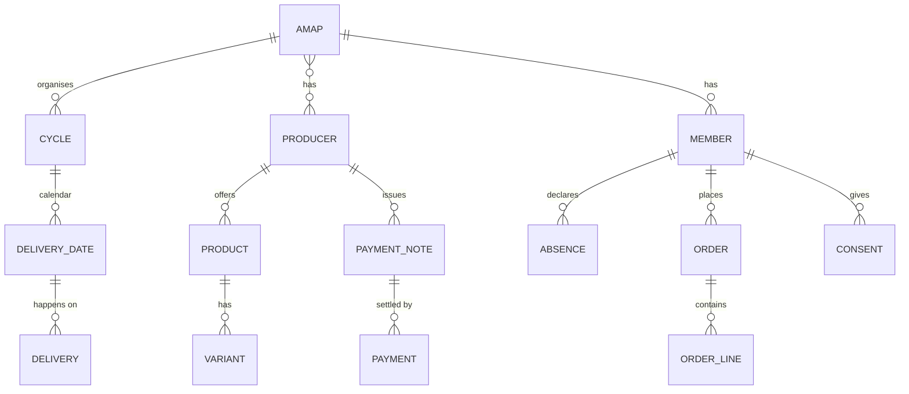

# Technique 2: Results of the document and current system analysis

**Updated on:** 13/10/2026
**Owner:** Bruno Alves
**Technique:** [Document and current system analysis](AnaliseDocumentacaoSistemaAtualEN.md)
**Focus:** **AMAP Porto (UPTEC Baixa)**, the AMAP for which the solution will be specified. Documents from the national network (REGENERAR) are used because AMAP Porto belongs to the network and follows its rules.

This document gathers the results of the four steps of the method: (1) source inventory, (2) information the system must store, (3) cross-check of documents against interviews and (4) gaps and questions. It complements the [analysis of each document](../doc_AMAP/AnaliseDocumentosAMAPEN.md) (candidate requirements DOC-01 to DOC-31) and Liane's analyses of the [order form](../doc_AMAP/FormularioEncomendas_AMAPPortoBaixa_PT.md) and the [news report](../doc_AMAP/ReportagemPublico_AMAPPorto_PT.md).

Points the group is not sure about are marked "to be confirmed". **No personal data** (contacts, tax numbers, IBAN) was copied from the original documents.

## 1. Sources analysed

### 1.1. Documents
| # | Document | Origin | Date | Produced by | Purpose |
|---|---|---|---|---|---|
| D-A | Form "Encomendas AMAP Porto Baixa > Jul a Dez 2026" (2 pages) | Moodle; shown in the 06/10 session | Jul–Dec 2026 cycle | The AMAP (shared form) and each producer (its own section) | Co-producers subscribe to the products for the semester |
| D-B | Terms and Conditions – AMAP UPTEC Baixa (v01) | Link on page 2 of D-A | Undated; mentions quarterly cycles | The AMAP producers | Accepted by co-producers when subscribing (data protection, registration, distribution) |
| D-C | AMAP Porto – Guide for new co-producers | Link on page 2 of D-A | Undated; mentions quarterly cycles | AMAP Porto | Onboarding of new co-producers (principles, payments, pickup, working groups) |
| D-D | Público news report, 28/09/2023 | Moodle | 2023 | Journalist | Context and history of AMAP Porto |
| D-E | AMAP Charter of Principles | [amap.movingcause.org](https://amap.movingcause.org/carta-de-principios/) (network website) | Approved on 15/12/2018 | National network (REGENERAR) | Principles every AMAP in the network must follow |
| D-F | Network FAQ | [amap.movingcause.org](https://amap.movingcause.org/perguntas-frequentes/) | Undated | National network | General rules: joining, payment, invoicing, dropping out |

### 1.2. Sessions used in the cross-check
| # | Session | Stakeholder |
|---|---|---|
| E-1 | 23/09 | Lecturer acting as the client (FAIR) |
| E-2 | 29/09 | Sofia Araújo, BioGoods (main producer of AMAP Porto) |
| E-3 | 06/10 | Luisa Marques, co-producer at AMAP UPTEC Baixa |
| E-4 | 07/10 | Lecturer, explanation of how new co-producers join (not recorded; to be confirmed whether it was said as the client) |

### 1.3. Documents still missing
| Priority | Document | Why it is needed |
|---|---|---|
| High | **BioGoods Excel file** (anonymised) | It is the producer's current system: stored data and monthly amount calculation |
| High | **Monthly payment note** sent to a co-producer | To know when and how the amount due is calculated (see C3) |
| Medium | Example of a producer's **invoice** | To confirm the invoicing rule (see C4) |
| Medium | **Email copy** of the form answers | What the co-producer sees today |
| Medium | **Distribution sheet** | Data for each delivery per co-producer |
| Low | Current versions of the Terms and the Guide (semester model) | To know whether the rules have changed |

## 2. The current system at AMAP Porto

Today AMAP Porto works with **several separate tools**, with no link between them:

| Tool | Used for | Users |
|---|---|---|
| **Google Forms** | Semester subscription: each producer's catalogue, personal data, consents | AMAP and co-producers |
| **Excel** (one per producer) | Co-producers, delivery dates, monthly amount calculation | Each producer (confirmed by BioGoods on 29/09) |
| **Email** | Copy of answers, late requests, notices, data protection requests | Everyone |
| **WhatsApp** | Basket contents, reminders, changes, one-off offers | Producers and co-producers |
| **MB Way, bank transfer, cash** | Direct payment to each producer | Co-producers |
| **Paper** | Distribution sheet; bags labelled with the co-producer's name | AMAP and producers |

**Problems observed:**
- A lot of information goes into **free text** in the form's comments: quantities, meat options, single items, bread rotation, absences. It is not structured (D-A).
- Some information is **not recorded anywhere**: whether the basket was picked up, what happens to the basket when the co-producer is away, substitutions for allergies or dislikes, and each co-producer's status (trial, active, waiting list).
- Co-producers depend on the **email copy** to know what they ordered and how much they owe each producer (D-C; 06/10 session).
- Important rules **do not appear on the form**: for example, the deadline to change the bread order (by Sunday) and dried mushrooms (06/10 session).
- After 19:30, baskets are **left outside** the pavilion, labelled with the name (D-B). This explains the pickup problems reported on 06/10.

## 3. Information the system must store

Main entities and fields identified in the documents. Every field has a source; the full detail is in the owner's working draft.

| Area | Entities | Main fields | Sources |
|---|---|---|---|
| Organisation | AMAP, pickup point | Name, location, day and time (configurable), AMAP email, rules (Terms, Guide) with version, assembly | D-A, D-B, D-C, E-2 |
| People | Producer, co-producer, member | Producer: contacts, certification, payment methods and rule, VAT scheme. Co-producer: name, email, mobile, **optional tax number**, adult declaration, exclusions (allergies/dislikes). Member: status (interested → trial → active → left), trial deliveries | D-A, D-B, D-C, D-F, E-2, E-4 |
| Personal data | Consent, data subject request | Type (Terms, Guide, studies), accepted version, date, withdrawal; access, rectification and erasure requests | D-A, D-B |
| Catalogue | Product, variant, price, delivery plan | Type (basket, extra, single item), seasonality, capacity and waiting list, storage; variant (tier, size, gluten-free); price (**fixed monthly fee, per unit or per actual kg**); frequency (fortnightly, monthly, quarterly, one-off, chosen dates, to be defined) | D-A |
| Cycle and orders | Cycle, delivery date, order, line | Period, order deadline, 13 dates; order status (submitted, late, confirmed after payment); chosen options and dates | D-A, D-B, D-C |
| Deliveries | Delivery, delivered item, absence | Bag "Name 1 of 2", **picked up? by whom?**, quantity and actual weight delivered, shortages and compensation; absence with what happens to the basket | D-A, D-B, D-F, E-2, E-3 |
| Payments | Payment note, payment, annual fee | Fixed fee + extras + actual weight − shortages; method, date, proof; annual fee of €10 (€5 to the network) | D-A, D-C, D-F, E-3 |
| Community | Working group, assembly, event, message | Distribution rotas, minutes, farm visits; reminders, basket contents, surplus offers | D-C, D-E, E-2, E-3 |

## 4. Cross-check of documents against interviews

**38 topics** were cross-checked:
- **21 confirmed** by both a document and an interview;
- **10 with differences** between sources;
- **3 only in the documents**;
- **3 only in the interviews**;
- **1 with a single source**.

### 4.1. Confirmed (examples)
- **Semester** cycle in 2026 (previously quarterly), 13 deliveries, **Tuesdays 17:30–19:30** (D-A, D-B, D-C, E-2).
- **Several producers** in the same AMAP, each with its own delivery and payment rules; payment goes **directly** to each producer (D-A, D-C, E-3).
- **Baskets have a fixed monthly fee** and extras are variable (meat by weight, mushrooms per delivery). This reconciles the 29/09 and 06/10 sessions (D-A).
- No pickup confirmation; bags labelled with the name (D-B, E-3).
- Anyone who cannot pick up arranges for someone else, or the basket is **donated or shared out**: it is never wasted (D-C, D-F, E-2, E-3).

### 4.2. Differences between sources
| # | Topic | What the sources say | Status |
|---|---|---|---|
| C1 | Who sets the dates | E-1: the management; E-3 and D-C: the producers | To be confirmed: do producers propose and the AMAP merge them into a shared calendar? |
| C2 | Basket name, price and weight | E-2: "farm basket", €32, ~4 kg. D-A: the €32 basket is the **Vegetable Basket** (~2.5–3 kg); the Farm Basket costs €26 | Name and price: the form prevails. **Weight to be confirmed** |
| C3 | When payment is made | D-A: start of each month, with a payment note; E-3: end of the month, based on what was delivered; D-F: always in advance | **Open**: needs the payment note |
| C4 | Tax number and invoicing | D-B: the tax number is processed; D-A: it is not asked; D-F: each producer issues **one overall invoice to the group** and individual invoices only on request | **Almost resolved**: the tax number is optional. To confirm with BioGoods |
| C5 | Absences and pauses | E-3: "no more holidays", the basket is always paid; E-2: rare pauses, case by case; D-F: anyone dropping out should **find a replacement** until the end of the cycle | Rule: always paid; exceptions case by case |
| C6 | Intermediation | D-E: AMAPs are set up "**without intermediary agents**"; E-1: possible FAIR commission; E-2: the AMAP as an intermediary in the future | **Group scope decision** (see 5) |
| C7 | Who manages the AMAP | D-C: volunteer working groups; E-2: the producer opens and closes orders | **Two-level management**: the AMAP (shared form, calendar, rules) and each producer (its own orders, confirmations and payment notes). D-F and E-4 confirm that producers send the form to whoever asks for it |
| C8 | Renewal deadline | E-2: ~3 months ahead, to plan crops; D-A: the form closes 3 days before the 1st delivery | The current system **does not meet** this need |
| C9 | Discount on extras | E-2: discount for basket holders; D-A: not shown | To be confirmed |
| — | Trial deliveries | D-C: **1** trial delivery; E-4: **2** | The most recent source (E-4) prevails; the number should be configurable |

### 4.3. Only the documents show
The stakeholders did not mention these points in the interviews:
- **Data protection:** the data controllers are **the producers**; there is an **optional** consent for studies; data subject rights (D-B, D-A).
- **The AMAP may refuse a registration**, which is only confirmed after payment (D-B).
- **Late requests** are assessed by the AMAP (D-A).
- **6 types of delivery frequency** and **3 pricing modes**, plus a rule to avoid duplicating blueberries (D-A).
- **The 19:30 rule** (D-B).
- The **annual fee** and common fund (D-C, D-F).
- **Cash** as a payment method (D-A).
- The Charter of Principles asks AMAPs to **assess their benefits continuously and transparently** (D-E). This gives a documentary basis for the indicators (KPIs) requested on 23/09.

### 4.4. Only the interviews show (gaps in the current system)
- **Exclusions and substitutions** per co-producer (allergies, dislikes). The form has no field for this, and D-F says **co-producers cannot choose the basket items**.
- **Configurable duration** and **early renewal** of the commitment.
- **Pickup confirmation** and choosing **what happens to the basket** during absences.
- **Reminders**, basket contents and weight before delivery, surplus offers.

## 5. Legal constraints

Summary of research done on 13/10/2026. It is an interpretation for this assignment, **not legal advice**.

| Topic | Rule | Implication for the solution | Source |
|---|---|---|---|
| Data protection (GDPR) | Several controllers who decide together are **joint controllers** and must set out an arrangement and a contact point (Art. 26) | Record, per AMAP, the controllers and the contact. FAIR would be a **processor** (Art. 28) | [GDPR Art. 26](https://gdpr-text.com/pt/read/article-26/) |
| | Consent must be **provable** and as easy to withdraw as to give (Art. 7) | Store date and version of consents; allow withdrawal | [GDPR Art. 7](https://gdpr-text.com/pt/read/article-7/) |
| | Reply to data subjects within **1 month** (Art. 12); breaches notified within **72 h** (Art. 33); records of processing when processing is not occasional (Art. 30) | Requests with deadlines; incident procedure; processing records | [Art. 12](https://gdpr-text.com/pt/read/article-12/), [Art. 33](https://gdpr-text.com/pt/read/article-33/), [Art. 30](https://gdpr-text.com/pt/read/article-30/) |
| | The Terms (D-B) base everything on consent | Order and invoicing data fit better under **contract** and **legal obligation**; consent should only cover optional uses (to be confirmed) | [GDPR](https://eur-lex.europa.eu/eli/reg/2016/679/oj/por) |
| Invoicing | Invoice to a private consumer: the **tax number is only required if they ask for it** (VAT Code Art. 40) | Optional tax number | [VAT Code Art. 40](https://info.portaldasfinancas.gov.pt/pt/informacao_fiscal/codigos_tributarios/civa_rep/Pages/iva40.aspx) |
| | Anyone invoicing with a computer program must use **software certified by the Tax Authority** (SAF-T, ATCUD, QR code) | **Proposal:** the system **does not issue invoices**; it records the invoice issued by the producer in their own software | [Vendus](https://www.vendus.pt/blog/obrigado-utilizar-software-certificado/), [InvoiceXpress](https://invoicexpress.com/blog/elementos-obrigatorios-faturas/) |
| | Producers may use different VAT schemes (standard, Art. 53 exemption, flat-rate farmers); food is taxed at 6% | Store the **VAT rate per product** and the **scheme per producer** | [VAT Code Art. 59-A](https://info.portaldasfinancas.gov.pt/pt/informacao_fiscal/codigos_tributarios/civa_rep/Pages/iva59a.aspx), [Circular 25062/2025](https://info.portaldasfinancas.gov.pt/pt/informacao_fiscal/legislacao/instrucoes_administrativas/Documents/Oficio_circulado_25062_2025.pdf) |
| Payments (PSD2) | A platform that **collects co-producers' money** and distributes it to producers provides a regulated payment service | Keep **direct payment** to each producer (FAIR calculates, shows and records) or use a licensed payment provider | [Clifford Chance](https://www.cliffordchance.com/briefings/2017/11/impact_of_psd2_ononlinemarketplacesoperatin.html), [Stripe](https://stripe.com/en-cz/guides/how-psd2-impacts-marketplaces-and-platforms) |

**For decision C6:** the Charter of Principles, the invoicing rules and PSD2 all point the same way: an **organisation tool for the AMAP, with no commercial, financial or tax intermediation**. The decision belongs to the group and should be confirmed with FAIR.

## 6. New candidate requirements

They continue the numbering in [AnaliseDocumentosAMAPEN.md](../doc_AMAP/AnaliseDocumentosAMAPEN.md) (DOC-01 to DOC-31).

| # | Candidate requirement | Source |
|---|---|---|
| DOC-32 | Allow **transferring a subscription** to another co-producer until the end of the cycle (dropping out) | D-F |
| DOC-33 | Configure the AMAP's delivery day, time, frequency and location | D-A, E-2 |
| DOC-34 | Record producer **compensation** for failed deliveries | D-F, E-3 |
| DOC-35 | Generate the **distribution sheet** per date | D-C, D-F |
| DOC-36 | Record the invoice issued by the producer (number, date), **without issuing it in the system** (to validate with the scope) | D-F, section 5 |
| DOC-37 | Indicators of the **AMAP's benefits** (co-producers, people fed, producers supported) | D-E, D-D, E-1 |
| DOC-38 | Manage the **joining process**: contact request → trial deliveries (configurable number) → sending the cycle form | E-4, D-F, D-C |
| DOC-39 | Store the co-producer's tax number only if they ask for an invoice with it | D-F, VAT Code Art. 40 |
| DOC-40 | Record and withdraw consents with proof (date, version); track data subject requests with a 1-month deadline | D-B, GDPR |
| DOC-41 | Store the VAT rate per product and the VAT scheme per producer | D-A, VAT Code |

## 7. Questions for the next sessions

**To the producer (BioGoods):**
1. Is the payment note sent at the end of the month, based on what was delivered, or at the start, for the coming month? Could you show an anonymised example? (C3)
2. Do you issue an invoice to each co-producer or one overall invoice? When do you ask for the tax number? (C4)
3. Could you share an anonymised version of the Excel file, or show its sheets and calculations?
4. What is the usual weight of the Vegetable Basket? (C2)
5. How far in advance do you need to know the orders for the next semester? (C8)
6. Are the 2 trial deliveries paid? Who decides whether there is a place? (joining)
7. Does the discount on extras for basket holders still exist? (C9)

**To the AMAP (co-producer / management group):**
8. Who prepares the shared form each semester? Are the working groups active? (C7)
9. Who approves the shared calendar? (C1)
10. Are there updated versions of the Terms and the Guide? Does the annual fee still exist?

**To the client (FAIR):**
11. Does FAIR intend to charge a per-transaction commission or a subscription? How does it see the "no intermediaries" principle? (C6)
12. Should the system issue invoices or only record payments? (C4, C6)
13. Can the 07/10 explanation about joining be used as a client requirement? (E-4)
