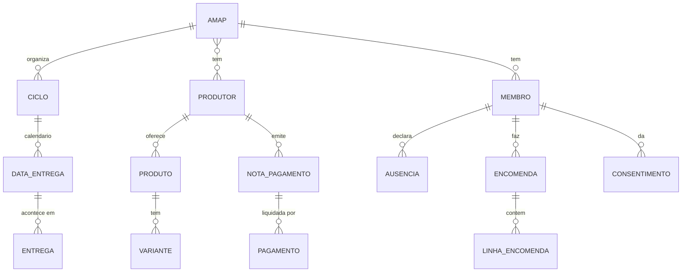

# Técnica 2: Resultados da análise de documentação e do sistema atual

**Atualizado em:** 13/10/2026
**Responsável:** Bruno Alves
**Técnica:** [Análise de documentação e do sistema atual](AnaliseDocumentacaoSistemaAtualPT.md)
**Foco:** a **AMAP Porto (UPTEC Baixa)**, a AMAP para a qual a solução vai ser especificada. Os documentos da rede nacional (REGENERAR) são usados porque a AMAP Porto pertence à rede e segue as suas regras.

Este documento junta o resultado dos quatro passos do método: (1) inventário de fontes, (2) informação que o sistema tem de guardar, (3) cruzamento dos documentos com as entrevistas e (4) lacunas e perguntas. Complementa a [análise de cada documento](../doc_AMAP/AnaliseDocumentosAMAPPT.md) (requisitos candidatos DOC-01 a DOC-31) e as análises da Liane do [formulário](../doc_AMAP/FormularioEncomendas_AMAPPortoBaixa_PT.md) e da [reportagem](../doc_AMAP/ReportagemPublico_AMAPPorto_PT.md).

Os pontos de que o grupo não tem certeza estão assinalados como "a confirmar". **Não foram copiados dados pessoais** (contactos, NIF, IBAN) dos documentos originais.

## 1. Fontes analisadas

### 1.1. Documentos
| # | Documento | Origem | Data | Quem o produz | Para que serve |
|---|---|---|---|---|---|
| D-A | Formulário "Encomendas AMAP Porto Baixa > Jul a Dez 2026" (2 páginas) | Moodle; mostrado na sessão de 06/10 | Ciclo jul.–dez. 2026 | A AMAP (formulário comum) e cada produtor (a sua secção) | O coprodutor subscreve os produtos do semestre |
| D-B | Termos e Condições – AMAP UPTEC Baixa (v01) | Ligação na pág. 2 de D-A | Sem data; refere ciclos trimestrais | Os produtores da AMAP | O coprodutor aceita-os ao subscrever (proteção de dados, inscrição, distribuição) |
| D-C | AMAP Porto – Guia para novos coprodutores | Ligação na pág. 2 de D-A | Sem data; refere ciclos trimestrais | A AMAP Porto | Integração de novos coprodutores (princípios, pagamentos, levantamento, grupos de trabalho) |
| D-D | Reportagem do Público, 28/09/2023 | Moodle | 2023 | Jornalista | Contexto e história da AMAP Porto |
| D-E | Carta de Princípios das AMAP | [amap.movingcause.org](https://amap.movingcause.org/carta-de-principios/) (site da rede) | Aprovada a 15/12/2018 | Rede nacional (REGENERAR) | Princípios que todas as AMAP da rede têm de cumprir |
| D-F | Perguntas frequentes da rede | [amap.movingcause.org](https://amap.movingcause.org/perguntas-frequentes/) | Sem data | Rede nacional | Regras gerais: adesão, pagamento, faturação, desistência |

### 1.2. Sessões usadas no cruzamento
| # | Sessão | Stakeholder |
|---|---|---|
| E-1 | 23/09 | Professor no papel de cliente (FAIR) |
| E-2 | 29/09 | Sofia Araújo, BioGoods (produtora principal da AMAP Porto) |
| E-3 | 06/10 | Luisa Marques, coprodutora da AMAP UPTEC Baixa |
| E-4 | 07/10 | Professor, explicação sobre a adesão de novos coprodutores (sem gravação; a confirmar se foi dita como cliente) |

### 1.3. Documentos que ainda faltam
| Prioridade | Documento | Para que é preciso |
|---|---|---|
| Alta | **Excel da BioGoods** (versão anonimizada) | É o sistema atual do produtor: dados guardados e cálculo do valor mensal |
| Alta | **Nota de pagamento mensal** enviada a um coprodutor | Saber quando e como se calcula o valor a pagar (ver C3) |
| Média | Exemplo de **fatura** de um produtor | Confirmar a regra de faturação (ver C4) |
| Média | **Cópia por email** das respostas ao formulário | O que o coprodutor vê hoje |
| Média | **Mapa (folha) de distribuição** | Dados de cada entrega por coprodutor |
| Baixa | Versões atuais dos Termos e do Guia (modelo semestral) | Saber se as regras mudaram |

## 2. O sistema atual da AMAP Porto

Hoje a AMAP Porto funciona com **várias ferramentas soltas**, sem ligação entre si:

| Ferramenta | Para quê | Quem usa |
|---|---|---|
| **Google Forms** | Subscrição semestral: catálogo de cada produtor, dados pessoais, consentimentos | AMAP e coprodutores |
| **Excel** (um por produtor) | Coprodutores, datas de entrega, cálculo do valor mensal | Cada produtor (a BioGoods confirmou na sessão de 29/09) |
| **Email** | Cópia das respostas, pedidos fora do prazo, avisos, pedidos de proteção de dados | Todos |
| **WhatsApp** | Composição do cabaz, lembretes, alterações, ofertas pontuais | Produtores e coprodutores |
| **MB Way, transferência, numerário** | Pagamento direto a cada produtor | Coprodutores |
| **Papel** | Mapa de distribuição; sacos com o nome do coprodutor | AMAP e produtores |

**Problemas observados:**
- Muita informação vai para **texto livre** nas observações do formulário: quantidades, opções da carne, avulso, rotação do pão, ausências. Não fica estruturada (D-A).
- Há informação que **não é registada em lado nenhum**: se o cabaz foi levantado, o destino do cabaz quando o coprodutor falta, as substituições por alergia ou gosto, e o estado de cada coprodutor (em experiência, ativo, em lista de espera).
- O coprodutor depende da **cópia por email** para saber o que encomendou e quanto deve a cada produtor (D-C; sessão de 06/10).
- Regras importantes **não aparecem no formulário**: por exemplo, o prazo para alterar o pão (até domingo) e os cogumelos secos (sessão de 06/10).
- Depois das 19h30 os cabazes **ficam no exterior** do pavilhão, identificados pelo nome (D-B). Isto explica os problemas de levantamento relatados a 06/10.

## 3. Informação que o sistema tem de guardar

Entidades e campos principais identificados nos documentos. Cada campo tem fonte; o detalhe completo está no rascunho de trabalho do responsável.

| Área | Entidades | Campos principais | Fontes |
|---|---|---|---|
| Organização | AMAP, ponto de entrega | Nome, local, dia e horário (configurável), email da AMAP, regras (Termos, Guia) com versão, assembleia | D-A, D-B, D-C, E-2 |
| Pessoas | Produtor, coprodutor, membro | Produtor: contactos, certificação, meios e regra de pagamento, regime de IVA. Coprodutor: nome, email, telemóvel, **NIF opcional**, maioridade, exclusões (alergias/gostos). Membro: estado (interessado → em experiência → ativo → saiu), entregas experimentais | D-A, D-B, D-C, D-F, E-2, E-4 |
| Dados pessoais | Consentimento, pedido do titular | Tipo (Termos, Guia, estudos), versão aceite, data, retirada; pedidos de acesso, retificação e eliminação | D-A, D-B |
| Catálogo | Produto, variante, preço, plano de entregas | Tipo (cabaz, extra, avulso), sazonalidade, capacidade e lista de espera, conservação; variante (escalão, tamanho, sem glúten); preço (**quota mensal fixa, por unidade ou por kg real**); periodicidade (quinzenal, mensal, trimestral, única, datas à escolha, a definir) | D-A |
| Ciclo e encomendas | Ciclo, data de entrega, encomenda, linha | Período, prazo de encomenda, 13 datas; encomenda com estado (submetida, tardia, confirmada após pagamento); opções e datas escolhidas | D-A, D-B, D-C |
| Entregas | Entrega, item entregue, ausência | Saco "Nome 1 de 2", **levantado? por quem?**, quantidade e peso real entregues, faltas e compensações; ausência com o destino do cabaz | D-A, D-B, D-F, E-2, E-3 |
| Pagamentos | Nota de pagamento, pagamento, quota anual | Quota fixa + extras + peso real − faltas; meio, data, comprovativo; quota anual de 10 € (5 € para a rede) | D-A, D-C, D-F, E-3 |
| Comunidade | Grupo de trabalho, assembleia, evento, mensagem | Escalas de distribuição, atas, visitas; lembretes, composição do cabaz, ofertas de excedentes | D-C, D-E, E-2, E-3 |

## 4. Cruzamento dos documentos com as entrevistas

Foram cruzados **38 temas**:
- **21 confirmados** por um documento e por uma entrevista;
- **10 com diferenças** entre fontes;
- **3 só nos documentos**;
- **3 só nas entrevistas**;
- **1 com uma única fonte**.

### 4.1. Confirmados (exemplos)
- Ciclo **semestral** em 2026 (antes trimestral), 13 entregas, **terça-feira 17h30–19h30** (D-A, D-B, D-C, E-2).
- **Vários produtores** na mesma AMAP, cada um com regras próprias de entrega e pagamento; pagamento **direto** a cada produtor (D-A, D-C, E-3).
- Os **cabazes têm quota mensal fixa** e os extras são variáveis (carne ao peso, cogumelos a cada entrega). Isto concilia as sessões de 29/09 e 06/10 (D-A).
- Levantamento sem confirmação e sacos com nome (D-B, E-3).
- Quem não pode levantar arranja alguém ou o cabaz é **doado ou distribuído**: nunca se perde (D-C, D-F, E-2, E-3).

### 4.2. Diferenças entre fontes
| # | Tema | O que dizem as fontes | Estado |
|---|---|---|---|
| C1 | Quem define as datas | E-1: a gestão; E-3 e D-C: os produtores | A confirmar: os produtores propõem e a AMAP junta tudo num calendário comum? |
| C2 | Nome, preço e peso do cabaz | E-2: "cabaz da quinta", 32 €, ~4 kg. D-A: o cabaz de 32 € é o **Cabaz de Legumes** (~2,5–3 kg); o Cabaz da Quinta custa 26 € | Nome e preço: vale o formulário. **Peso a confirmar** |
| C3 | Momento do pagamento | D-A: início de cada mês, com nota de pagamento; E-3: fim do mês, conforme o que foi entregue; D-F: sempre antecipado | **Em aberto**: precisa da nota de pagamento |
| C4 | NIF e faturação | D-B: o NIF é tratado; D-A: o NIF não é pedido; D-F: cada produtor emite **uma fatura global ao grupo** e fatura individual só a quem a pedir | **Quase resolvido**: o NIF é opcional. Confirmar com a BioGoods |
| C5 | Ausências e pausas | E-3: "acabaram as férias", paga-se sempre; E-2: pausas raras, caso a caso; D-F: quem desiste deve **encontrar um substituto** até ao fim do ciclo | Regra: paga-se sempre; exceções caso a caso |
| C6 | Intermediação | D-E: as AMAP são constituídas "**sem intervenção de agentes intermediários**"; E-1: possível comissão da FAIR; E-2: a AMAP como intermediária no futuro | **Decisão de âmbito do grupo** (ver 5) |
| C7 | Quem gere a AMAP | D-C: grupos de trabalho voluntários; E-2: a produtora lança e fecha as encomendas | **Gestão em dois níveis**: a AMAP (formulário comum, calendário, regras) e cada produtor (as suas encomendas, confirmações e notas de pagamento). D-F e E-4 confirmam que os produtores enviam o formulário a quem o pede |
| C8 | Prazo de renovação | E-2: ~3 meses antes, para planear as culturas; D-A: o formulário fecha 3 dias antes da 1.ª entrega | O sistema atual **não responde** a esta necessidade |
| C9 | Desconto nos extras | E-2: há desconto para quem tem cabaz; D-A: não aparece | A confirmar |
| — | Entregas experimentais | D-C: **1** entrega experimental; E-4: **2** | Prevalece a fonte mais recente (E-4); o número deve ser configurável |

### 4.3. O que só os documentos mostram
Os stakeholders não referiram estes pontos nas entrevistas:
- **Proteção de dados:** os responsáveis pelo tratamento são **os produtores**; há um consentimento **opcional** para estudos; direitos do titular (D-B, D-A).
- **A AMAP pode recusar uma inscrição**, que só fica confirmada depois do pagamento (D-B).
- **Pedidos fora do prazo** são avaliados pela AMAP (D-A).
- **6 tipos de periodicidade** e **3 modos de preço**, e a regra que evita duplicar o mirtilo (D-A).
- **A regra das 19h30** (D-B).
- A **quota anual** e o fundo comum (D-C, D-F).
- O **numerário** como meio de pagamento (D-A).
- A Carta de Princípios pede que as AMAP **avaliem de forma continuada e transparente os seus benefícios** (D-E). Isto dá base documental aos indicadores (KPI) pedidos a 23/09.

### 4.4. O que só as entrevistas mostram (lacunas do sistema atual)
- **Exclusões e substituições** por coprodutor (alergias, gostos). O formulário não tem campo para isto, e D-F diz que **não se escolhem os produtos do cabaz**.
- **Duração configurável** e **renovação antecipada** do compromisso.
- **Confirmação do levantamento** e escolha do **destino do cabaz** nas ausências.
- **Lembretes**, composição e peso do cabaz antes da entrega, ofertas de excedentes.

## 5. Restrições legais

Resumo de pesquisa feita a 13/10/2026. É uma interpretação para o trabalho, **não aconselhamento jurídico**.

| Tema | Regra | Implicação para a solução | Fonte |
|---|---|---|---|
| Proteção de dados (RGPD) | Vários responsáveis que decidem em conjunto são **responsáveis conjuntos** e têm de definir um acordo e um ponto de contacto (art. 26.º) | Indicar, por AMAP, os responsáveis e o contacto. A FAIR seria **subcontratante** (art. 28.º) | [RGPD art. 26.º](https://gdpr-text.com/pt/read/article-26/) |
| | O consentimento tem de poder ser **provado** e retirado tão facilmente como foi dado (art. 7.º) | Guardar data e versão dos consentimentos; permitir retirá-los | [RGPD art. 7.º](https://gdpr-text.com/pt/read/article-7/) |
| | Resposta aos titulares em **1 mês** (art. 12.º); violações notificadas em **72 h** (art. 33.º); registo de atividades quando o tratamento não é ocasional (art. 30.º) | Pedidos com prazo; procedimento de incidentes; registo de tratamento | [art. 12.º](https://gdpr-text.com/pt/read/article-12/), [art. 33.º](https://gdpr-text.com/pt/read/article-33/), [art. 30.º](https://gdpr-text.com/pt/read/article-30/) |
| | Os Termos (D-B) baseiam tudo no consentimento | Os dados da encomenda e da faturação assentam melhor no **contrato** e na **obrigação legal**; o consentimento fica para o que é opcional (a confirmar) | [RGPD](https://eur-lex.europa.eu/eli/reg/2016/679/oj/por) |
| Faturação | Fatura a um consumidor particular: o **NIF só é obrigatório se ele o pedir** (art. 40.º do CIVA) | NIF opcional | [CIVA art. 40.º](https://info.portaldasfinancas.gov.pt/pt/informacao_fiscal/codigos_tributarios/civa_rep/Pages/iva40.aspx) |
| | Quem fatura com um programa informático tem de usar **software certificado pela AT** (SAF-T, ATCUD, código QR) | **Proposta:** o sistema **não emite faturas**; regista a fatura emitida pelo produtor no programa dele | [Vendus](https://www.vendus.pt/blog/obrigado-utilizar-software-certificado/), [InvoiceXpress](https://invoicexpress.com/blog/elementos-obrigatorios-faturas/) |
| | Os produtores podem estar em regimes de IVA diferentes (normal, isenção do art. 53.º, forfetário agrícola); os alimentos têm taxa de 6% | Guardar a **taxa de IVA por produto** e o **regime por produtor** | [CIVA art. 59.º-A](https://info.portaldasfinancas.gov.pt/pt/informacao_fiscal/codigos_tributarios/civa_rep/Pages/iva59a.aspx), [Ofício 25062/2025](https://info.portaldasfinancas.gov.pt/pt/informacao_fiscal/legislacao/instrucoes_administrativas/Documents/Oficio_circulado_25062_2025.pdf) |
| Pagamentos (PSD2) | Uma plataforma que **recebe o dinheiro** dos coprodutores e o reparte pelos produtores presta um serviço de pagamento regulado | Manter o **pagamento direto** a cada produtor (a FAIR calcula, mostra e regista) ou usar um prestador de pagamentos licenciado | [Clifford Chance](https://www.cliffordchance.com/briefings/2017/11/impact_of_psd2_ononlinemarketplacesoperatin.html), [Stripe](https://stripe.com/en-cz/guides/how-psd2-impacts-marketplaces-and-platforms) |

**Para a decisão C6:** a Carta de Princípios, as regras de faturação e a PSD2 apontam todas no mesmo sentido: uma **ferramenta de organização da AMAP, sem intermediação comercial, financeira nem fiscal**. A decisão é do grupo e deve ser confirmada com a FAIR.

## 6. Requisitos candidatos novos

Continuam a numeração de [AnaliseDocumentosAMAPPT.md](../doc_AMAP/AnaliseDocumentosAMAPPT.md) (DOC-01 a DOC-31).

| # | Requisito candidato | Fonte |
|---|---|---|
| DOC-32 | Permitir **transferir uma subscrição** para outro coprodutor até ao fim do ciclo (desistência) | D-F |
| DOC-33 | Configurar o dia, o horário, a frequência e o local de entrega da AMAP | D-A, E-2 |
| DOC-34 | Registar as **compensações** do produtor por falhas de entrega | D-F, E-3 |
| DOC-35 | Gerar a **folha de distribuição** por data | D-C, D-F |
| DOC-36 | Registar a fatura emitida pelo produtor (número, data), **sem a emitir no sistema** (a validar com o âmbito) | D-F, secção 5 |
| DOC-37 | Indicadores dos **benefícios da AMAP** (coprodutores, pessoas alimentadas, produtores apoiados) | D-E, D-D, E-1 |
| DOC-38 | Gerir o **processo de adesão**: pedido de contacto → entregas experimentais (número configurável) → envio do formulário do ciclo | E-4, D-F, D-C |
| DOC-39 | Guardar o NIF do coprodutor apenas se ele pedir fatura com NIF | D-F, CIVA art. 40.º |
| DOC-40 | Registar e retirar consentimentos com prova (data, versão); acompanhar pedidos dos titulares com prazo de 1 mês | D-B, RGPD |
| DOC-41 | Guardar a taxa de IVA por produto e o regime de IVA por produtor | D-A, CIVA |

## 7. Perguntas para as próximas sessões

**À produtora (BioGoods):**
1. A nota de pagamento é enviada no fim do mês, com o que foi entregue, ou no início, para o mês que começa? Pode mostrar um exemplo anonimizado? (C3)
2. Emite fatura a cada coprodutor ou uma fatura global? Quando pede o NIF? (C4)
3. Pode partilhar uma versão anonimizada do Excel, ou mostrar as folhas e os cálculos?
4. Qual é o peso habitual do Cabaz de Legumes? (C2)
5. Com que antecedência precisa de saber as encomendas do semestre seguinte? (C8)
6. As 2 entregas experimentais são pagas? Quem decide se há vaga? (adesão)
7. O desconto nos extras para quem tem cabaz ainda existe? (C9)

**À AMAP (coprodutora / grupo de gestão):**
8. Quem prepara o formulário comum em cada semestre? Os grupos de trabalho estão ativos? (C7)
9. Quem aprova o calendário comum? (C1)
10. Há versões atualizadas dos Termos e do Guia? A quota anual ainda existe?

**Ao cliente (FAIR):**
11. A FAIR pretende cobrar comissão por transação ou uma subscrição? Como vê o princípio "sem intermediários"? (C6)
12. O sistema deve emitir faturas ou apenas registar os pagamentos? (C4, C6)
13. A explicação de 07/10 sobre a adesão pode ser usada como requisito do cliente? (E-4)
